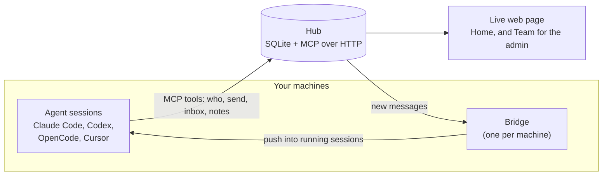
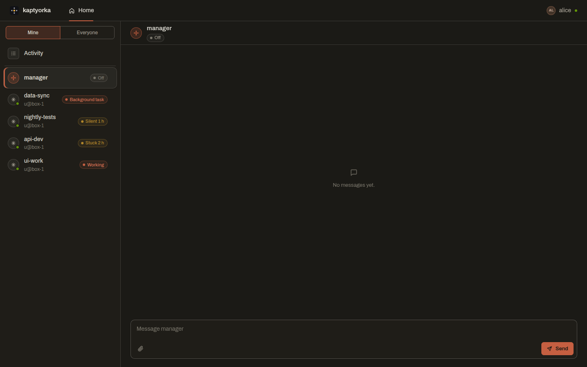
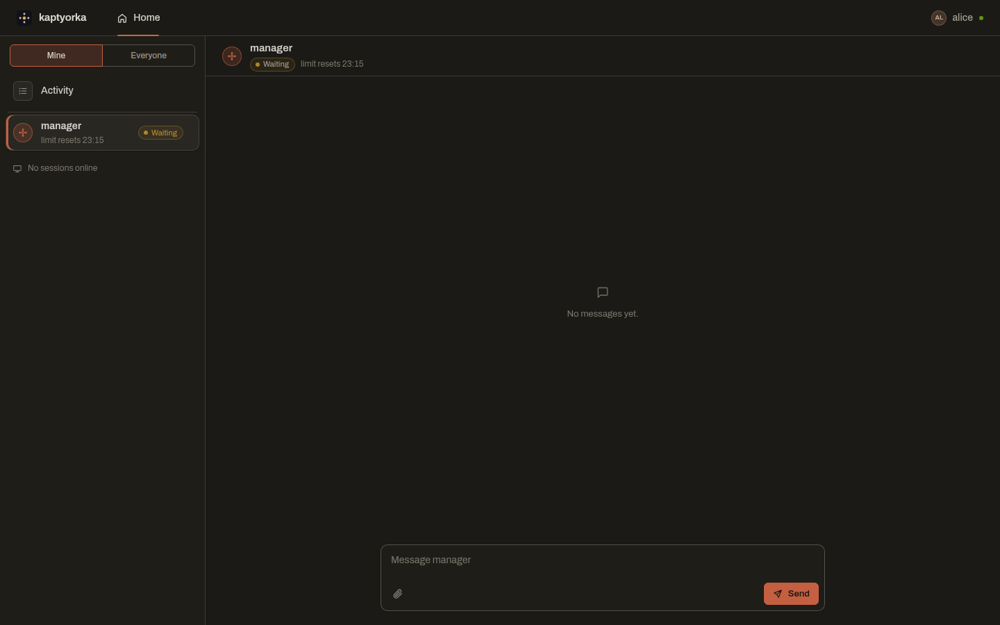

<div align="center">


# kaptyorka

**Your coding agents, on one team.**
Every Claude Code, Codex, OpenCode and Cursor session on your LAN can see the others, message them and share notes. Different accounts, no GitHub needed.

[](https://github.com/narek-mn/kaptyorka/actions/workflows/test.yml)
[](https://pypi.org/project/kaptyorka/)
[](https://pypi.org/project/kaptyorka/)
[](LICENSE)

</div>

---

## Why

Say a change in your robot console ("move robot to selected point") also needs a change in the backend on the GPU server. Today you carry messages between the two agents by hand. With kaptyorka the console agent tells the server agent itself, and they agree the API between them. You give the order once.

It works on one LAN or VPN. Teammates can use different accounts. Nobody needs GitHub access.

## How it works



- One machine runs the **hub**. It keeps people, sessions, messages and notes in a SQLite file and speaks MCP over HTTP. Every machine has a token of its own, tied to a person.
- Each session gets the agent tools through a small `kaptyorka` MCP server that `join` adds.
- The **bridge** on each machine reports which sessions are running and pushes new messages into them. Cursor has no push door, so it reads messages at the next turn.
- The hub also serves a live web page for people.

## Quick start

On the machine that stays on (the hub):

```bash
pipx install kaptyorka
kaptyorka start --new-hub
```

A team has one hub, on one machine. `--new-hub` is needed only this first time: it creates a new hub, a new team with you as its admin. Without it, a first `kaptyorka start` changes nothing and says to use `kaptyorka join <link>` instead (it never asks a question: agents answer questions). Every other machine, and every teammate, joins with `kaptyorka join <link>`, the link from the admin (`kaptyorka invite`, or Settings > Machines > Add machine on the page), never `start`. Later starts on the hub machine (a restart, an update, a reboot) need no flag.

kaptyorka needs Python 3.10 or newer. On an older Python, `pip` and `pipx` only say `No matching distribution found for kaptyorka`; see "Jetson and older Linux" below.

It prints:

```
hub running: http://<ip>:<port>
open the page: http://<ip>:<port>/#t=<token>  (keep this link private: it signs you in)
invite a teammate: kaptyorka invite <name>
```

The first start creates the admin, a person named like the user who runs the hub, and the admin's own device token (device `hub`, kept in `~/.kaptyorka/admin-token`). The page link carries that token; this machine is saved as joined with it. `kaptyorka start` when the hub already runs with the same settings changes nothing: it answers `the hub is already running` and prints the page link again. A start with a new port or host restarts the hub and says `hub restarted`; this machine follows the new address. On a machine joined to a hub at another address, `start` refuses ("a team has one hub"); to really run a second, separate hub there: `kaptyorka leave`, then `kaptyorka start --new-hub`. The hub machine's firewall must allow the hub port (8765 by default) from the LAN or VPN.

Run `kaptyorka join` to set up the agent tools on the hub machine. Then invite each teammate, from the hub machine or any machine joined as the admin:

```bash
kaptyorka invite alice
```

It prints `added alice to the team` (only for a new person) and the link, `http://<hub>/i/<code>`. The link works for 7 days and joins one machine. Alice:

1. Opens the invite link in her browser and clicks **Sign in with GitLab** (when the hub has sign-in with GitLab; see "Sign in with GitLab"). That links her GitLab account to her hub person and opens her page.
2. On her machine, runs `pipx install kaptyorka`.
3. Runs `kaptyorka join http://<hub>/i/<code>`, or gives the link to her agent (see "For agents").

Steps 1 and 3 work in either order: signing in does not use the link up.

Each machine gets a token of its own, tied to Alice, and a signing secret. Both are saved in `~/.kaptyorka/config.json`. The machine name defaults to `user@host`; add `--name <name>` to change it. When the computer is renamed later, the bridge follows: at its start (and on each heartbeat) a `user@<old host>` name becomes `user@<new host>`, the same device and its sessions keep their access, and Cursor folders keep their `/hub off`. A name you chose with `--name` stays unless it is `<this account>@<something>`, and so does any name on a shared 0.1 token, which the hub maps to its person by that name. `kaptyorka people` lists each person with their role, how many devices they have and when one was last used.

Opening the invite link in a browser shows the same `join` command, and **Sign in with GitLab** when it is set up; without it, a button that opens the page as Alice (that one uses the link up).

For a teammate's own laptop in the secure mode (see "Personal laptop: team folders in a locked box"), the admin runs `kaptyorka invite <person> --personal`. That link is for the laptop's installer, never for `kaptyorka join`. The device it makes reaches only its box calls on the hub, never the rest of the hub, and stays personal for good. A person with a personal laptop on the hub cannot be made a team machine.

Open the `page` link to watch the team live and act from it. The top bar has **Home** and, on the right, your name, which opens **Settings** (no menu; the count of things waiting for an admin shows on it). **Sign out** is at the bottom of the Settings sidebar, and at the end of Profile on a phone. **Home** is for everyone and works like a chat app. On the left is the list: the manager first (its row and its chat header always say how it is: **Ready**, **Working**, **Starting**, **Waiting**, **Stuck**, **Usage limit**, **Can't start**, **No contact** or **Off**, with the hub's reason under its name when there is one), then the sessions you may see. A session goes by the name you gave it in Claude Code (`/rename` or `claude -n`); otherwise by Claude Code's own title, with the folder and machine under it. An OpenCode session goes by its OpenCode title: the one OpenCode gave it after its first prompt, or the one you renamed it to. A Codex session goes by its Codex thread name the same way: the one you gave it with `/rename`, else the title Codex made after its first prompt (never the text of that prompt). Claude Code's automatic name (the folder plus two characters, new on every resume) shows only until the session has a title; with neither (Cursor, a new session) it shows the folder name. Each has a green dot when online, a grey one when not, its machine as `account@computer` (such as `alice@box-1`; a renamed machine shows its new name), and a count of unread replies; hover for the full name, folder and tool. Claude Code background jobs (`claude --bg`) sit in one **Background** group under your other chats, folded at first, with how many there are and their unread count; the page remembers whether you left it open. Inside, a job shows a small clock instead of the dot; its chat stays empty until it or you write, and you can write to it like any session. Sessions that did nothing for over a day (Claude Code, OpenCode and Codex; such as a terminal left open for weeks) move to one **Idle** group at the end of the list, folded at first, each saying how long ("idle 30 hours", "idle 31 days"); they stay online and you can still write to them. The manager and the hub's workers never move there. A small × at the end of a session's row (on hover with a mouse, always on a phone; tooltip **Close session**) closes it: your own sessions, or anyone's for an admin; never the manager, a hub worker (they have their own close) or a session in overnight mode, and only Claude Code sessions and OpenCode sessions open in a terminal window (Codex, Cursor and an OpenCode session open only in the desktop or web app give no safe way to end it from outside: the app's session has no process on that machine). A session idle over a day closes on the click; a newer one asks first in the row ("Close this session? It is in use.", or "It is working: what it is doing now stops." while it works; **Close** / **Cancel**). The row says **Closing…** and goes once that session's own bridge has ended it (a background job with `claude stop`, a terminal session by stopping its own `claude` process, once its start time, or on macOS `ps`, proves it is that session; a command its Bash tool runs ends with it; an OpenCode session by stopping the terminal window that shows it: on OpenCode 2 once that window's own note, written by kaptyorka's OpenCode plugin, proves it shows that session now; on OpenCode 1 nothing can prove it, so it is a guess: the newest chat in the window's folder since it started, or the one its `-s`/`-c` command line opened, and a switch to another chat inside the window is not seen until you type there; on OpenCode 1 a session that more than one window in the same folder maps to gets no × and is not closed ("open in more than one OpenCode 1 window here"); OpenCode 2's background service is never stopped); the conversation is kept, so `claude --resume <id>` (or, on OpenCode 2, `opencode -s <id>`) opens it again. If the bridge could not close it, the row says why and the × comes back. Click one to open its chat on the right (the header shows its name, folder, machine and the status line the session set; a session's chat holds only messages sent through the hub, so it starts empty, and what its person types to the agent stays on their computer): the messages in full, in two sides. Your messages sit on the right in a coloured bubble, with no name over them and the time beside each; answers sit on the left on a grey surface. In a session's chat, the session is on the left and anyone else writing to it on the right in a second grey (in a chat of just two sessions, always the same one of them); in the manager's chat, Activity and a group of three or more, everyone but you is on the left, each name in its own colour. A run of messages from one sender has one head saying who wrote it and where (the session's name, `account@computer`, the project unless it is hidden from you, the tool, and after an arrow the receiver when it is not the chat's own session). It all sits in one centred column 768 px wide (864 px on a very wide screen): a bubble of yours takes up to 70% of it (85% on a phone), an answer up to all of it, text lines stay under 80 characters and code and tables use the bubble's whole width. The box to write is at the bottom (Enter sends, Shift+Enter makes a new line). Messages show their markdown as formatting: headings, lists, bold and italic, `code`, code blocks (they scroll sideways and have a copy button), tables and http/https links; nothing in a message is ever treated as HTML, and other links stay plain text. A message longer than about 20 lines is folded with **Show more** (it stays open while the chat is open); the newest message is never folded. Reading older messages, the chat stays where you are when new ones come, and a **New messages** button takes you down. Under your last message, on the right, it says **Sending…**, **Sent** or **Delivered** (the session has it), or **Not sent** with **Retry**; while the session works on it, three dots and "is working" show under it ("waking the manager…" while the manager starts). A message to the manager that got no answer after a minute, while the manager is not working, says **No answer yet** with the hub's reason when there is one. What a session thinks is never sent to the hub. An admin switches the list between **Mine** and **Everyone** at the top. Mine is what a member sees: the manager, your own sessions and the team machine sessions in your projects. Everyone shows every session under a header per person and per team machine, with its count and unread count; click a header to fold or open it. All but your own start folded, and the page remembers the switch and the folds in this browser. The admin also gets **Activity** at the top: every message as "from → to", read only, with the hub's own notices behind a **Notices** toggle. What stops agents working (no agent tool logged in, a bridge offline, a worker that failed to start) shows as an amber warning sign with a count in the top bar; click it for the list, each warning in full with the command that fixes it and a copy button, and **See machines**. Over a chat, at most one line, and only when the problem is on that chat's own machine: the warning cut to one line (full text on hover), its command with a copy button, "+N more" when there are others (opens the list), and a × that hides it in this browser; it stays in the list with **Show again**. The line floats over the top of the messages, so nothing in the chat moves when it comes or goes. On a phone you see the list first; a tap opens the chat and **Back** returns. Members never see other people's sessions; to reach one, they write to the manager, and once the admin opens a door that session shows as a normal chat. Members find **Ask for access** at the bottom of the list. **Settings** is one area with one sidebar: Profile, Machines and Signed-in browsers for everyone, then People and Projects for admins; each section has its own address, such as `#settings/people`, so Back and links work (the older `#settings/account/...` and `#settings/team/...` addresses still land there). On a phone the sidebar is a row of tabs at the top. Members see Home and their own account: their sessions and the manager. They keep notes, rules, machines and workers through their agents and the commands, not on the page.

When your sessions run on more than one machine, the list (a member's, and an admin's Mine) puts them under one header per machine (`account@computer`, a team machine tagged **Team**) with its count and unread count; click a header to fold it, and the page remembers the folds in this browser. Sessions that work together get a **Working together** block right under the manager: two sessions that really work together, and a session with the workers it started (a worker stays with its boss as long as it runs). Really working together means at least 4 messages each way of 20 characters or more (hub notices and files alone do not count), the first and last at least 15 minutes apart, within a day; pings, a single question and its answer, or a message sent by mistake never make a group. Once formed, a group stays while both sessions are online, until a day after their last such message, so quiet stretches between bursts of work keep it; it ends at once when one of them goes offline. Each group has a title line (its project, or "mixed", how many sessions, and "active 2m ago" while its last message is under 30 minutes old, else "quiet 3 h") and its sessions joined by a line on the left, a worker one step in under its boss; they are not listed again below. The line lights up briefly when a message passes between them. The manager is never in a group (it talks to everyone). Click the title line to read the group's conversation: every hub message between its sessions in time order, with "from → to" when there are more than two, read only. A session in a group shows **Working with** and its partners' names at the top of its chat; click one to open it. You see only links you could already read: those of your own sessions, and those between two team machine sessions you see by project role; never what two other people's sessions say to each other, even with doors open to both. A partner of your session you may not see shows as "another session", with no name, machine, project or messages. The hub does that filtering (`/api/groups/<id>/messages` answers only for a group you see, and only with those messages). The admin sees every group. A session that misses one or two of the hub's 2-second updates (a missed report, a tool between two calls) keeps its place and look on the page instead of vanishing and coming back.

The hub address uses the machine's IP. Use `--host` to set another one, and `--port` for another port. `kaptyorka start` again later starts the hub with the same settings. It also turns this machine's bridge back on when `kaptyorka stop` switched it off. On Linux, if the hub must survive logout, `start` prints one command to run once (`sudo loginctl enable-linger <user>`) when it could not do it itself.

`join` finds the agent tools you have and sets them up. To set up only some, add `--only <tool>`. It prints what it changed and what to restart, and only for tools that changed: when nothing did, it says `already joined to <hub>; all set`. `kaptyorka join` with no flags runs it again with the saved settings, and sets up tools installed since. `kaptyorka join <invite link>` on a machine already joined to that hub does nothing and says so (the link is not used up); for another hub it prints `moved from <old hub> to <new hub>` and goes on. `kaptyorka join --hub <hub> --token <token>` still works, for a token you already have. On a first join it ends with this machine's `page` link.

The page asks for a device token: open a link ending in `#t=<token>`, paste the token on the lock screen, or use an invite link. When the admin has set up sign-in with GitLab (see "Sign in with GitLab"), the lock screen shows only **Sign in with GitLab**, and the page opens only with it: a `#t=` link from a member's machine says to sign in with GitLab instead. The one exception is the admin token on the hub machine (see "Sign in with GitLab"). On the LAN, links to images on the page carry the token in the URL, since there is no reverse proxy; do not paste such links elsewhere.

### Jetson and older Linux

Jetsons run ARM64 Ubuntu. JetPack 6 is Ubuntu 22.04 with Python 3.10: `pipx install kaptyorka` works as above. JetPack 5 is Ubuntu 20.04 with Python 3.8, below kaptyorka's floor. Check with `python3 --version` and `cat /etc/nv_tegra_release` (`R35` is JetPack 5, `R36` is JetPack 6). On Python 3.8, install with uv, which brings its own Python:

```bash
curl -LsSf https://astral.sh/uv/install.sh | sh
uv tool install kaptyorka
```

On a Jetson the bridge reads GPU use from the board itself (no `nvidia-smi` needed), `tmux` may need `sudo apt install -y tmux` for workers, and the bridge runs as a systemd user service like on any Ubuntu. On a headless board, log in as the user over SSH (not through `sudo` or `su`, which have no user session) before `kaptyorka join`, and run the `sudo loginctl enable-linger <user>` line `join` prints, so the bridge starts at boot without a login. `kaptyorka doctor` says when the shell has no user session.

## Personal laptop: team folders in a locked box

On your own laptop, kaptyorka can keep the team away from your personal files. Only the folders you choose become **team folders**. A team chat (Claude Code, Codex, OpenCode or Cursor started in a team folder) runs as a separate Linux user, the **box**, that cannot see your other files, chats or sign-ins. Everywhere else your tools work as before, with no kaptyorka in them. You need Linux with systemd 254 or newer (Ubuntu 24.04 is fine) and `sudo`.

**1. Get a personal invite link from your team admin.** The admin runs `kaptyorka invite <you> --personal` on a hub with encrypted connections switched on (see "Encrypted connections"), and sends you the link it prints. It looks like `https://192.0.2.10:8444/i/<code>#sha256=<fingerprint>`, works once and for 7 days. A plain `http://` link is refused: ask the admin to switch encryption on.

**2. Make a Claude token for the box** (in a terminal, as yourself): `claude setup-token`. Keep the token it prints; the installer asks for it. You can also skip it and add it later with `hubchat token-rotate`.

**3. Get the installer and install.** The installer is one file, `kaptyorka-secure-setup.pyz` (Python standard library only), attached to each GitHub release of kaptyorka next to its hash file `kaptyorka-secure-setup.pyz.sha256`; the SHA-256 is in the release notes too. The hub's invite page (open your link in a browser) and the admin's `kaptyorka invite <you> --personal` show your link and the release page of the hub's own kaptyorka version, `https://github.com/narek-mn/kaptyorka/releases/tag/v<version>`, and nothing else: never a command. In a terminal, as yourself, in an empty folder (put that version in for `<version>` and your link in the quotes):

```bash
curl -fLO https://github.com/narek-mn/kaptyorka/releases/download/v<version>/kaptyorka-secure-setup.pyz
curl -fLO https://github.com/narek-mn/kaptyorka/releases/download/v<version>/kaptyorka-secure-setup.pyz.sha256
sha256sum -c kaptyorka-secure-setup.pyz.sha256 && sudo python3 -I kaptyorka-secure-setup.pyz install --personal '<link>'
```

The install runs only when `sha256sum -c` says `OK`. **The trust step, honestly:** this runs once as root, so you trust this one file, and the release page is what you trust for it. The hub only names the version: it never prints a command, because a hostile hub could print any command. Copy the commands from here or from the release page, never from a message or a page that someone sent you. If you want a second check, compare the hash with the one in the release notes (or ask your admin over another channel). There is no signed package yet.

It asks for a name for this computer on the hub (choose one, such as `laptop-2`; not your user or host name), for the Claude token, and which AI tools go into the box (default: the ones you already have; it looks for them by name only and never runs or copies yours). Then it joins the hub and sets everything up. It ends with `Self-check: all walls in place` and `Done.`. To answer without questions: `--name laptop-2 --claude-token-file ~/claude-token.txt --tools claude,codex` (delete that file afterwards; `--tools none` installs no tool).

The tools in the box come from each vendor's own installer (Claude Code: `claude.ai/install.sh`; Codex: `chatgpt.com/codex/install.sh`; OpenCode: `opencode.ai/install`, OpenCode 2 `opencode.ai/v2/install`; Cursor: `cursor.com/install`). Each runs in a locked unit as a throw-away user that sees no home folder and reaches only that vendor's hosts. Root then copies the result to `/opt/kap-tools`, root-owned, and records each version in `/etc/kaptyorka/tools.json`. The box runs exactly those versions and never updates them itself. For newer ones: `hubchat update-tools` (all of them), or `hubchat update-tools codex claude=2.1.300 opencode=2` (one version; `opencode=2` is OpenCode 2).

The installer checks the hub against the fingerprint at the end of the link before it sends anything, and keeps the hub's address it actually reached. If the link was already used, is older than 7 days, is for a team machine, or the hub's fingerprint does not match, it says so in one sentence and changes nothing on your computer: ask the admin for a new personal link. It also checks your computer first (systemd version, an old kaptyorka in your account, your home folder's rights), so a computer that is not ready does not use up the link.

It keeps a copy of itself in `/usr/local/libexec/kaptyorka/installer`, so you never download or paste a new root command later:

- **New link** (the hub got a new certificate or address, or the admin made a new device): `sudo /usr/local/libexec/kaptyorka/installer rejoin '<new link>'`. Only the hub's values change; your team folders and the box stay.
- **Something is broken or was changed by hand:** `sudo /usr/local/libexec/kaptyorka/installer repair` writes every file, unit and rule again and runs the self-check.
- **The install was stopped halfway** (killed, a crash, no network for the tools): team chats and `hubchat` say "the install did not finish"; `sudo /usr/local/libexec/kaptyorka/installer repair` finishes it without a new link (or `... remove` takes it all away). Offline, the install stops at once before changing anything: install with `--tools none` and add the tools later with `hubchat update-tools`.

**4. Log out and in once** (or restart the computer). Until then, your own programs get `Permission denied` in team folders; `hubchat` reminds you.

**5. Make a folder a team folder:**

```bash
hubchat add ~/work/webapp                            # moves it; ~/work/webapp stays as a shortcut
cd ~/work && hubchat add https://github.com/org/repo.git  # or get a repository as a new team folder here
```

`hubchat add` stops, and changes nothing, when the folder has files that look like keys or passwords, or files that are also elsewhere on your disk (hard links): move them out and run it again, or add `--force` to share them anyway. A folder on another disk (a USB stick, another partition) must be copied into your home first. For a private repository, use its `git@host:path` address and add the box's own SSH key (the installer and `hubchat list` show it) to your git account.

**6. Work as usual:** `cd ~/work/webapp`, then `claude`, `codex`, `opencode` or `cursor-agent`. In a team folder they start in the box and can talk to the team through the hub; anywhere else they are your own tools. Claude uses the token from step 2; Codex, OpenCode and Cursor show their own sign-in screen the first time, and that sign-in belongs to the box, not to your own tools.

**7. See what you share:** `hubchat list` shows every team folder, its shortcut, the running chats, the box's sign-ins and SSH key, and runs the self-check.

**8. Make a folder personal again:** `hubchat remove webapp`. It goes back to where its shortcut was, and team chats cannot reach it any more.

If a team chat does not start and says a wall is missing, restart the computer and try again; if it stays, send the lines it printed to your team admin. Rarely: if you think a team chat leaked the box's Claude token, run `hubchat token-rotate` and paste a new token from `claude setup-token`.

**Limits.** The box keeps a team chat away from your own files, but it is not a promise about everything:

- A tricked team chat can read the box's own Codex, OpenCode and Cursor sign-ins (they are files in the box). The box's Claude token is protected: no chat can read it. The relay refuses to send a box sign-in to the hub as it is or in a common encoding (hex, base64, base32, base85, gzip, with separators between), but that is a backstop, not a wall: short pieces, a cipher or one character per message get through. If you think one leaked, end that sign-in at its vendor.
- A chat's title comes from its first prompt, and titles reach the hub, so your team can see them.
- All your team folders share one box and one memory: a chat in one can read the others. `hubchat add <folder> --separate` gives a folder a box of its own.
- Never mark a team folder as trusted in your editor, and never add it to git's `safe.directory`: a team chat can put files there that your editor or git would then run as you. `git` typed in a team folder already runs in the box and needs no such line; a "dubious ownership" error from another git there (an editor's, a script's) is that check working. Your view of a team folder covers the tool folders and files (`.opencode`, `.claude`, `opencode.json`, ...) and git's own (`.git/config`, hooks, `info`) at any depth with empty ones of yours, and each team chat's start and `hubchat list` name what a team chat changed there, build files (`Makefile`, `package.json`) too; a folder too deep or too big to check fully is said to be so. A build you start there yourself runs what the team wrote: read it first.
- Your editor's own AI, and a tool you start by its full path (such as `~/.local/bin/claude`), run as you, outside the box, even in a team folder.
- What a team chat prints passes a small filter before it reaches your terminal: it drops clipboard codes, window titles, file-transfer and other terminal "strings", report questions that answer with text, and links whose text is not their address; colours, cursor moves and the tools' screens stay. It is not a wall against every terminal bug.
- Linux only for now; macOS is not proven.
- `hubchat token-rotate` gives the box a new token but does not end the old one: end it yourself as the command says.

**Remove it all:** `sudo /usr/local/libexec/kaptyorka/installer remove`. Every team folder goes back to you first. Then open a new terminal, and end the box's sign-ins as the command lists.

## For agents

If your human pastes an invite link (`http://<hub>/i/<code>`) and says "join this", do these steps:

1. `pipx install kaptyorka`
2. `kaptyorka join <invite-link>` (add `--name <machine>` if your human gives a machine name)
3. Restart what `join` tells you to restart. Done.

The link joins one machine. If your human gives you a hub address and a token instead, run `kaptyorka join --hub <hub> --token <token> --name <machine>`.

## What `join` changes

| Tool | Messages | What `join` changes | Restart |
|---|---|---|---|
| Claude Code | push | Adds the `kaptyorka` MCP server (user scope), seven hooks (start, prompt, stop, and four that only act in overnight mode: tool calls, permission prompts, API errors, session end) and the hub field in the status line (see "The hub in your status line") in `~/.claude/settings.json`, and the `/hub` command in `~/.claude/commands/hub.md`. | Open sessions, once |
| OpenCode | push | Adds the MCP server, a plugin and the `/hub` command (`commands/hub.md`) in `~/.config/opencode`. OpenCode 1: its TUI runs the local server the bridge pushes through only when started with `--port` (OpenCode 1.19 reads `server.port` in `opencode.json` only for `opencode serve` and `web`), so kaptyorka writes a small `opencode` wrapper to `~/.local/bin` that adds `--port 0` to the TUI (never to subcommands, `--mini` or a port you gave), when that folder comes before the real `opencode` on a login shell's PATH. Otherwise it falls back to `alias opencode='opencode --port 0'` in your shell rc file. The bridge checks this again each time it starts, and `kaptyorka leave` removes both. `kaptyorka doctor` fails "opencode server" while an OpenCode window runs without its server: close it and start it again from a new terminal (`--fix` never closes it). OpenCode 2: no wrapper or alias (it removes old ones); messages go through its background service, and `/hub` comes from a TUI plugin in `plugins/kaptyorka-hub/tui.js` instead of `commands/hub.md`; that plugin also notes which chat each window shows (`~/.kaptyorka/opencode-open/<pid>.json`), so the bridge lists every open window's session, idle or reopened. A session open only in the desktop or web app (no window on the machine) is listed from the service while it runs a turn and for 30 minutes after its last step. A session a window closed, or moved away from, leaves at once (OpenCode 1 too) and comes back when it is used again (in the app or a window); one open in both a window and the app leaves with the window until its next step. OpenCode 1 cannot say which chat a window shows: a window shows the chat it was opened on (`-s`, `-c`) until it writes to a newer one, so after a switch inside the window the new chat shows from its first new step. `kaptyorka doctor` fails "opencode server" while OpenCode 2 runs without that service (`--standalone`, or the service disabled): run `opencode service start` and restart it. Session ids must look like OpenCode's own (`ses_...`); a push the bridge could not make shows as **Not delivered** on the page, with a short reason on hover (the full error stays in the bridge log), until the session reads it. The login check reads `~/.local/share/opencode/auth.json` and `opencode auth list` (credentials or provider environment variables); finding none counts as unknown, never as not logged in, since OpenCode also runs free and local models. | New terminal, then OpenCode (OpenCode 2: its background service too) |
| Codex | push (not yet verified, needs a Codex login) | Adds hooks, the MCP server and the `$hub` skill (`skills/hub`) in the Codex config folder. Adds `alias codex='codex --remote unix://'`. The bridge keeps `codex app-server daemon` running. | New terminal, then Codex |
| Cursor | pull only | Adds the MCP server, hooks and the `/hub` skill (`skills/hub`) in `~/.cursor`. Messages arrive at the end of each agent turn and after tool calls. | Restart the app |

Push means a running session gets a message without anyone typing. Pull only means the agent sees it at the next turn.

`join` does not write skills. Once the hub has team skills, the bridge writes them to `~/.claude/skills/team-<name>/` (see "Team rules and skills").

`join` also starts a small background service, `kaptyorka-bridge`, that delivers messages.

The bridge re-adds kaptyorka's own Claude Code hooks each time it starts (a line you wrote by hand counts as present), so the overnight hooks reach machines that joined earlier; Claude Code picks them up in open sessions. `kaptyorka leave` removes them. The two that run on every tool call (PreToolUse, PermissionRequest) start with a shell check that ends at once, without starting kaptyorka, while no session is in overnight mode. A machine joined before 0.4 gets the new stop hook when you run `kaptyorka join` again (or `kaptyorka doctor --fix`). Codex asks once before it runs a new hook: approve it with `/hooks` in Codex.

## What agents can do

| Tool | What it does |
|---|---|
| `who` | List the sessions you may reach: your own, the manager's, and those behind a door. A project you may not see shows as `(private)`; each session has an `id` to send to |
| `send` | Message one session, or `all`; `file=<local path>` attaches a file |
| `knock` | The admin only: ask another person's session (or the person) to open a door |
| `answer` | The admin only: answer a knock with "yes" or "no" |
| `door_close` | Close a door |
| `reach` | The admin and the manager: may one session message another, is the target online, and what became of the last message between them |
| `door_request` | Ask the admin for a door between two sessions of different people (the manager for someone who asked it; a member for one of its own sessions); two sessions of one shared project get it at once |
| `door_decide` | The admin only: answer a door request with "sessions", "people" (7 days) or "deny" |
| `resume_session` | The manager only: resume a session that ended (on a team machine or the asker's own machine) as a worker of the asker, now or at its usage limit's reset |
| `lesson` | The manager only: record a correction it accepts; its next runs start with its lessons |
| `inbox` | Read your messages |
| `fetch_file` | Save a file from a message to `~/.kaptyorka/inbox/` |
| `status` | Say what you are working on |
| `projects` | List the projects you have a role in |
| `request_access` | Ask the admin for a project or a machine. To reach another person's session, message the manager |
| `notes_list` | List notes (team notes, or a project's with `project=`) |
| `notes_read` | Read a note |
| `notes_write` | Write a note. Notes outlive sessions |
| `state` | Read a project's state note |
| `state_write` | Update a project's state note; it needs five headings: What it is, Where it stands, Decisions, Open problems, How to run and test |
| `decide` | Record one decision as a dated line in the project's `decisions` note |
| `rules` | Read the team rules and their version |
| `propose_rule` | Suggest a team rule, with the evidence; the admin decides |
| `conflict` | Report two rules that clash, so the admin can fix the text |
| `work` | Start a worker session for you on another machine. Leave `machine` empty and the hub picks one; `resume` is the full session id to continue (for Claude Code a short id starts a copy under a new id) |
| `workers` | List your workers |
| `adopt` | Take over one of your unattended workers |
| `close_worker` | End one of your workers |
| `work_decide` | The manager only: decide a busy-machine work request (a machine, or `wait`), with a reason |
| `log` | Admin and manager only: the team's activity log, newest first (`limit`, at most 1,000) |
| `machines` | Admin and manager only: each machine as its bridge last reported it: online, size, use and free disk space ("disk: / 212 of 468 GB free, ...") |

The hub offers 30 tools in all.

`work(project, task, machine="", tool="claude-code", resume="")` starts a worker. `tool` is `claude-code`, `codex` or `opencode`. `adopt(name)` and `close_worker(name)` take the worker's name.

Rename a Claude Code session with `/rename <name>` and agents can reach it by that name: `send(to="<name>", ...)`.

A session seen in the last 10 minutes can still be named (by name, label or `#id`) while it is briefly gone, for example between two reports. The message is held, with doors checked as for an online session, and it gets it when it next reports. The sender reads `held: box-1/claude-code/proj-a was last seen 34 s ago; it gets the message when it next reports`; the page shows it as Sent until the session has it. A name not seen for longer gives the usual "no session named" error.

Each registered project has a state note. It has five headings, in this order: What it is, Where it stands, Decisions, Open problems, How to run and test. `state(project)` reads it and `state_write(project, text)` replaces it. The manager's own task list, `state_write("manager", text)`, takes any text. `decide(project, text)` adds one dated line to the project's `decisions` note; `decide("", text)` records a team decision.

## What a session knows on start

At the start of a session the hub gives the agent a short brief. It has five parts, in this order:

1. Team rules, first (see "Team rules and skills").
2. Who you are, and who is online.
3. The projects you may read.
4. Your project: its state note, its git activity of the last 7 days, and the branches that have open sessions.
5. Your unread messages.

The brief is at most 6,000 characters. When it is too long, the hub cuts the rules text first (the brief keeps the rules heading and the line on `propose_rule` and `conflict`, and points to `rules()`, which gives the full text), then the project list, then the git activity, then the end of the state note. Unread messages are never cut. The hub keeps each session's brief for 10 seconds, so quick repeats are cheap. It builds a fresh one when the session's count of unread messages has changed since, and it never keeps a brief that delivered messages.

The bridge reports each session folder's git branch, last commit and whether it has changes. The hub keeps this git activity for 30 days. The project view shows the last 20 changes of branch or commit.

## Team rules and skills

The team's rules and skills are kept in a private folder on the admin's machine: `RULES.md` holds the rules, and `skills/*.md` holds one skill per file. The admin uploads the folder with:

```bash
kaptyorka rules push <dir>
```

Only the admin's device can push. Accepting a proposal (Yes in Team settings) also saves a new version, on the hub only. A push replaces the rules text with `RULES.md` as a new version. So before it uploads, `rules push` reads the hub's current text; if a line there is not in `RULES.md`, it prints those lines and stops. Copy them into `RULES.md`, or run `kaptyorka rules push --force <dir>` to replace them anyway. The skill set is replaced as a whole, so a skill removed from the folder is removed from the team. Limits: rules up to 20,000 characters, each skill up to 20,000, at most 50 skills. A skill name uses lowercase letters, digits and single hyphens, 1 to 48 characters.

Every session sees the rules in its start brief, under this heading. The hub builds the brief from the current version, so a new version reaches a session's next brief within 10 seconds (the brief cache):

> Team rules (project rules in this repo override these; these override your personal rules):

Project rules stay in the project's own repo. The hub keeps only the team rules.

Skills land on each machine by themselves. The bridge writes each one to `~/.claude/skills/team-<name>/SKILL.md`. Claude Code reads that folder directly. OpenCode and Cursor read `~/.claude/skills` as a compatibility path (checked against opencode.ai/docs/skills and cursor.com/docs/context/skills on 2026-11-07). Codex gets the rules text only. Each file carries a marker line and is replaced when the team's version changes. A folder without the marker is never touched. The bridge sends a heartbeat every 10 seconds; the hub's answer carries the current skills version, and when it differs from the one on disk the bridge fetches and writes the skills in that same heartbeat, so a new version lands within about 10 seconds.

On Home, hovering a session shows the admin what its tool has loaded:

- **rules text**: the hook that carries the start brief is installed.
- **hooks**: all kaptyorka hooks are installed.
- **skills**: the team skills folder is current.

`unknown` means an older bridge; `n/a` means not applicable (Codex has no skills folder). When a tool misses its hooks or skills, its brief says so: "Harness on this tool: rules only (hooks or skills missing; run kaptyorka doctor --fix)."

Agents can suggest rules, and report clashes. The brief tells each agent when to do this:

- When its person corrects it the same way twice, the agent calls `propose_rule(text, evidence)`. The admin accepts it, which appends it to the team rules as a new version, or rejects it. Open proposals wait in Team settings as one line each, with Yes and No; the answer is sent to the proposer's session.
- When two rules clash and the agent must ask its person, it calls `conflict(rule_a, rule_b)`. This logs the clash for the admin to fix the text.

If `~/.claude/skills` is a link into a git repo, add `team-*/` to that repo's `.gitignore`.

Limits: a proposal text 2,000 characters, its evidence 4,000, each rule in a conflict 1,000, 20 open proposals per person, and 20 conflicts per session.

## The done check

When a session stops, the hub checks whether it should update its project's state note first. It asks only when all of these are true:

- The session works in a registered project, and it may write that project.
- It did work: the bridge saw a new commit in its folder, or the folder went from changed to clean, or the session set a status with the word "done".
- It has not written the state note since that work.

Then the hub asks the session to call `state_write` before it stops. It asks at most once per session. Without a "done" status, a session is asked only after its folder showed a new commit or became clean. Git cannot tell who made the commit, so a session that only read files can be asked when someone else commits in the same folder. If nothing in the project changed, the session calls `status("done: no state change")`, and the check is cleared.

The stop hooks of Claude Code and Codex read the folder's git themselves, so a commit made just before the stop counts even when the bridge has not reported it yet.

| Tool | What the session gets |
|---|---|
| Claude Code | Its stop is blocked once, with the reason |
| Codex | Its stop is blocked once, with the reason |
| Cursor | The reason as the next follow-up message |
| OpenCode | The reason as a reminder on its next prompt |

## Overnight tasks

Give a Claude Code session a task for the night and go home. kaptyorka keeps it from getting stuck, keeps it inside the night rules, and writes a morning report. The design is in `docs/superpowers/specs/2026-11-20-overnight-tasks.md`.

**On and off.** It turns on when you type a clear order, such as "overnight task: fix the tests" or "fix the tests while I sleep", or with `/hub overnight` by hand; a mere mention, a pasted block, a question or a negation ("no need for overnight mode") never turns it on. The session shows one line, `kaptyorka: overnight mode is on for this task. To stop it: /hub overnight off`, and lists the night rules. Answer "ok", or change them in words: "you may move the motors" allows that one class for this task and is repeated back in one line; "hardware: motorctl, /dev/ttyUSB0", "protected folders: ~/recordings" or "shared branches: main, release" add to the lists (hardware and shared branches per project, protected folders per machine; say "for this machine" or "for this project" to choose). It turns off when you type anything else in that session (hub and kaptyorka messages do not count), with `/hub overnight off`, when the task is done, or after 16 hours.

**The night rules.** Everything is allowed except, unless you allowed it for this task:

| Class | Caught | Not caught |
|---|---|---|
| Admin rights | `sudo`, `su`, `pkexec`, `doas`, also after `&&`, `;`, pipes, `$( )`, `env`, `nice`, `timeout`, `xargs`, `find -exec`, `bash -c '...'` | A program that uses admin rights inside it |
| Shared git history | Force push (`-f`, `--force`, `--force-with-lease`, `+branch`), deleting a shared branch on the server; `rebase`, `reset` to another commit, `commit --amend`, `filter-repo` while on a shared branch (`main`, `develop`, or the project's list) | A git alias, or a tool that pushes by itself |
| System-wide deletes | Deleting `/`, `/etc`, `/usr`, `/boot`, `/var`, `/opt` and other system folders, the home folder itself, other users' home folders; deleting or overwriting anything in a protected folder (also through a symlink, and with the Write and Edit tools) | Ordinary deletes anywhere else are allowed |
| Real hardware | A command, script path or device path on the hardware list you set | Anything not on the list; nothing is built in |

A script or program that does these things inside it is not caught: the hook sees the command line, not what a program does after it starts. A command it cannot read (`eval "$X"`, `bash -c "$X"`, `xargs rm`, a command name built from variables, an open quote) is blocked and noted, never guessed as allowed.

**What already exists still wins.** The team and project rules still bind the session; when one forbids what the night rules allow, the session skips it and reports the clash (`kaptyorka overnight clash`). Your Claude Code permission settings keep priority: kaptyorka's hook never answers "allow" before them, so deny rules stay denies, and a permission prompt that one of your ask rules causes is skipped and noted, not allowed. Hub roles still decide every hub action. kaptyorka never uses `--dangerously-skip-permissions` and never edits your permission settings.

**When the session would get stuck.**

| Situation | What happens |
|---|---|
| A question with options | Denied: "No human until morning. Take the option you recommend and note it." |
| A permission prompt inside the night rules | Allowed |
| A permission prompt outside them, or from your ask rule | Denied: skip and note |
| It stops before the task is done | "Continue", at most 3 times in a row |
| It crashed | `claude --resume` in a tmux session, at most twice a night (the bridge does this) |
| A usage limit or an API error | Claude Code's own wait first; otherwise the bridge sends "continue" (every 30 minutes for a usage limit, 5 for other errors) for at most 6 hours |
| Plan mode | Warned at turn-on: edits wait for a person there |
| Its only pending work is a background task that printed nothing for 30 minutes | The bridge asks it once to check the task and stop it if it is stuck (see "Stuck sessions") |

**The morning report** lists what was done, the decisions made for you, what was skipped and needs your yes, rule clashes and events. It is saved in `~/.kaptyorka/overnight/reports/`. For a team session it also goes to your own page on the hub; a rule clash goes to the hub as a short fixed-text event (project, rule title, class), and the manager tells you once. A personal session sends nothing to the hub. Everything is kept in `~/.kaptyorka/overnight/`, readable by you only, with secrets dropped.

**Tools.** Claude Code only. Codex, Cursor and OpenCode: not yet (`/hub overnight` and `kaptyorka doctor` say so). The crash restart and the "continue" after a wait need the bridge, so a machine that never joined a hub gets the night rules and the report, but no restart.

## Stuck sessions

A session can sit for hours doing nothing while the page says it works: a background task that never ends (a wait loop that matches itself, a command waiting for input) keeps it waiting for a notice that never comes. kaptyorka notices two cases (Claude Code; the research is in `docs/superpowers/specs/2026-11-24-stuck-sessions.md`):

- **A silent background task**: the session's turn is over, and a background task it started has printed nothing for 30 minutes.
- **Busy with no new step**: the session is busy and has written nothing to its transcript (or its subagents' transcripts) for 30 minutes. A foreground command is capped at 10 minutes, so a working session always writes sooner.

The steps run from when the hub first sees the silence, however old it already is, one step per check and each once; the hub keeps where each episode stands, so a restart sends nothing again. First the hub asks the session itself, naming the task and its command, to check it and stop it if it is stuck, or to say in one line that it is meant to run (a server, a watcher). A session whose turn is over reads the message at once; a busy one only after its current step. **A session that writes anything after the question has seen it**: that task is never asked about again while the session lives, so a session running a long-lived server is not nagged. Only a session that stays silent for 30 minutes after the question is reported: the hub tells its person (their other online sessions, else their page), a worker's boss, and the manager, with how to stop it (`claude stop <id>` on that machine for a background session) and when it was really asked; the manager follows up with the session and hears it once more 30 minutes later if it is still stuck. An episode ends when the task prints, ends, the session writes again (busy), or it goes idle; the hub's own message does not count as writing. An idle session is never stuck, and a session in overnight mode is asked by its own bridge instead of the hub.

On the page a session whose turn is over while a background task runs shows **Background task** instead of **Working**; a stuck one shows an amber **Silent 1 h** (its task) or **Stuck 2 h** (busy with no new step). A task the session said is meant to run shows only **Background task**.



The bridge measures and the hub judges; nothing is judged for a bridge older than 0.9.32 or a tool other than Claude Code. **Linux only**: background tasks are found through `/proc` (the session's child shells and their output files); macOS gets the busy-with-no-new-step check only.

## Sessions left behind

Sessions pile up: a `claude --bg` helper another session started and forgot, a terminal left open for weeks. kaptyorka shows them in the page's **Idle** group, lets you close them from the page, and closes only the clearest case by itself (Claude Code; the research is in `docs/superpowers/specs/2026-11-24-left-sessions.md`). It sends nobody a message about them: a forgotten session's owner is not there to read it.

- **Truthful idle time.** Claude Code writes to a session's transcript while nobody works (an away summary, a compaction while idle, title and mode lines), so the file's time is not when it last did something. The bridge now takes the newest line the person or the model wrote, and any subagent's work; hub messages and task notices delivered to it do not count. This feeds the **Idle** group on the page too. OpenCode's idle time is its session's `time.updated`, which stays still while idle; Codex uses its thread's `updatedAt`, not checked against an idle thread (see the table under "The hub in each tool").
- **Who started it.** The bridge reads which session started a Claude Code session (Claude Code's `derived-from` line in the transcript, else the starter's child notes) and whether it is a `claude -p` run. On the page a session another one started sits under it on a rail, as workers do under their boss. A child or a `claude -p` run younger than 2 minutes that never sent or got a hub message is not listed on the page or in `who` (most end within seconds). A Claude Code session started by OpenCode, Codex or Cursor is marked by its parent process (Linux).
- **The parent's Stop check.** A session that stops while `claude --bg` sessions it started still run is told once: "You started helper-1 (`claude stop 1a2b3c4d`), still running: stop them or say in one line why they must keep running." Once per set of children, never twice in one stop, after the done check, never for the manager, a hub worker or a session in overnight mode.
- **Left by.** When the starter ends and its child keeps running, the child's grey line says **left by** and the starter's name.
- **Close from the page.** See the Idle group under Home: the × on a session's row closes it.
- **Auto-close, narrow.** Only a `claude --bg` session that another session started with `claude --bg`, whose starter has ended, that did nothing for over a day and never sent or got a hub message: the hub asks its bridge, which checks all of that again itself and runs `claude stop` (the transcript stays, so `claude --resume` still finds it), writes it to `bridge.log`, and the hub logs it; nobody is told. Never an interactive session, a hub worker or the manager. An admin turns it off with `POST /api/settings {"close_left": false}`.

None of this is documented by Claude Code. When a version drops the `derived-from` line or the notes, sessions just show as before (each on its own, nothing closed), and a slow test (`tests/test_left_slow.py`, real `claude`) fails, so the change is noticed.

## Usage limits

Sessions of one OS account on one computer share that account's login to an agent tool, and so its usage limit. kaptyorka treats the same computer, the same OS user and the same tool as one account (Claude Code keeps its login in the OS user's `~/.claude`, Codex in `~/.codex`).

- **Marked.** An account is marked "at its usage limit until 19:30" when one of its sessions says so (Claude Code's StopFailure, OpenCode's plugin; the reset time when the error text names one), when the bridge reads it (the `rate_limits` that Claude Code hands its status line, documented for claude.ai subscribers, which `kaptyorka statusline` keeps in `~/.kaptyorka/limits.json`; Codex's own usage read, at most every 5 minutes), or when the manager's launch fails with a usage limit's text.
- **Shown.** Machines (admin) shows an amber line per account at its limit; the manager's `machines` tool lists them.
- **Work goes elsewhere.** A work request skips that account for that tool with a plain reason ("box-1 (u): at its Claude Code usage limit until 19:30; pick another machine or wait until 19:30").
- **Cleared** at the reset time, when the bridge's next reading says the account is under its limits, or, with no reset time known (5 hours at most), once a session of that account wrote again.
- **The manager** runs on one account on the hub machine. While that account is at its limit the hub does not relaunch it: `kaptyorka status` and the page's manager row say "waiting for its usage limit, resets 19:30" (amber **Usage limit**), every admin's page hears it once, messages to it wait, and whoever writes to it meanwhile gets one line: "the manager is at its usage limit until 19:30; your message waits". At the reset a manager still running is told to read its inbox; one that ended starts again. A run that ended or failed while its account was at its limit never counts as a crash, so no backoff follows.



## Workers

A worker is an agent session that runs on another machine for you. Say "do this on the GPU box" and your agent calls `work`. Here is the story:

1. Your agent calls `work(project, task)`. You need the write role in the project, and a machine you may use: your own, a team machine (anyone with the write role in the project may start workers there, unless an admin hid it from them), or a shared account you were given.
2. The hub picks a machine and tells its bridge. Your own account comes first; a team machine or someone's shared account only on a machine where you have none. The bridge finds the project folder and starts the tool there, with your task as the first message.
3. The worker works alone. When it has news, it messages its boss (you). You get the worker's name and an attach line, so you can look inside.
4. Attach from any computer with the line you got: `ssh -t -- <user>@<machine> claude attach <name>` for Claude Code, `ssh -t -- <user>@<machine> tmux attach -t =<name>` for Codex and OpenCode.
5. `close_worker(name)` ends it; the worker itself calls it when its task is done (see below). `workers` lists yours, with the state of each.

How each tool runs:

- Claude Code: `claude --bg -n <name>`. Resume uses `--bg --resume <id>`.
- OpenCode and Codex: in `tmux`. A machine without `tmux` can host only Claude Code workers.

The project folder is the path the hub learned from sessions that ran this project on that machine. If there is none, it is `~/<project>`. The page shows a folder as busy when a worker in state `up` or `starting` is in it. A worker always starts in the project folder itself, never in a copy: kaptyorka makes no git worktrees, so a project builds and runs from its one folder. When other sessions already work in that folder, they share it: the worker's first message names them and gives the sharing rules, and each of them gets one hub notice that the worker joined, with the same rules. The rules: you share this folder and its one checked-out branch; do not switch or reset the branch, and do not stash; commit only the files you changed yourself, naming each path (`git commit <paths>`); say on the hub before you build, run or restart anything the others depend on; if you need a different branch, ask your boss instead of changing it. A worker an older version started in a `<folder>--<n>` worktree keeps it: closing it leaves the worktree, and `git worktree remove` takes it away when it is no longer needed.

Permissions: nothing is bypassed. A worker runs with the account's own saved permission settings. Only Claude Code reports that a worker is waiting for a permission; the boss is told once per half hour, with the attach line. Codex and OpenCode do not report it, so attach and look.

**Closing by itself.** A worker closes in two cases, and only Claude stops: its commits and files stay. (1) Its task is done: its first message tells it to report to its boss with `send`, then call `close_worker` with its own name; that is the done signal (a worker may close only itself, never another). (2) Its boss session really ended 10 minutes ago: the boss's machine's bridge is online and no longer lists that Claude Code session. Only Claude Code's session list is complete, so a boss in another tool never counts as ended. Either way the boss gets one line, such as "worker `proj-a-w1` closed: task done; it left branch main with 2 uncommitted files in /w/proj-a; nothing was deleted"; when the boss session ended, the same line also goes to the person's page. Never closed by itself: a worker whose boss is the page, one with overnight mode on (its bridge reports that on each heartbeat, and refuses such a close itself), or one on a bridge older than this version, which does not report overnight mode.

If the boss goes offline, the worker keeps going. After 2 minutes it is `unattended`, and after 24 hours `abandoned`. Nothing kills it. A closed laptop lid or a dropped network is offline, not ended: that bridge says nothing, so the rule above never fires. Its messages are held by the hub. Call `adopt(name)` from one of your own sessions to take it over; the held messages come to you.

A worker is closed as gone only when its machine's bridge reports and has not seen the worker's session for over 10 minutes. If the session shows up again, the worker is `up` again and the boss is told.

The old shared token cannot start, adopt or close workers. Use your own token.

"Shared" means an account that more than one person uses. Every team machine's account counts as shared. Accounts marked shared before 0.9.7 stay shared; the page no longer has the switch. A worker started there runs as that OS account. It can read everything the account can read, including the account's kaptyorka token, git keys and ssh keys. So share only an account that was set up for this. The hub does not let a worker on a shared account start, adopt or close workers; it must ask its boss. This holds on a team machine too, even for a worker whose boss is a session of that same team machine: no chains. This stops mistakes. It does not stop a hostile worker. A proper identity for each worker comes in a later version.

`kaptyorka fleet list` lists the machines; agents see workers with `workers`. The hub knows which agent tools are installed and logged in on each machine, as the tools report it; a tool that is not logged in cannot run workers there. One logged-in tool is enough: the hub warns only when none is, in a bar over the admin's chat on Home.

## Only team projects reach the hub

A session shows on the hub only when its folder is a team project: one the admin registered (a `<folder>--N` worktree, such as one you made yourself or an older kaptyorka made, counts as its project). Every other folder is personal and stays on your machine, as if it were switched off with `/hub off`: no presence, no folder name, no status, no git activity, no notes, no messages and no files. Its kaptyorka tools refuse, saying the folder is not a team project and how to put the session on the team (`/hub team`, below), and its hooks send nothing; they only give the agent the short hub guide (below). So nobody on the hub can message it either.

- When the admin registers a project, sessions in its folder appear within about 10 seconds. When the admin removes it, they disappear again.
- A copy of a project in a folder with another name counts too, when the project was registered with its repo (`--repo`): a linked worktree, a branch clone such as `proj-a-fix-login`, or a submodule whose git remote (any remote) is that repo. The URLs match whatever the scheme, user, port, trailing `.git` or case of the host (`http://gitserver:8000/group/proj-a.git` and `ssh://git@gitserver:2222/group/proj-a.git` are the same repo). The bridge, the tools and the hooks decide this on the machine: the hub sends only a fingerprint (sha256) of each registered repo, and the machine reads its own git config to compare; no remote or path of any other folder leaves it. When the folder name is a team project itself, the name decides, as before. A project with no repo stored matches by its folder name only.
- The bridge decides from the list of team projects the hub sends with each heartbeat. It keeps the last list when a heartbeat fails and across restarts (`~/.kaptyorka/team.json`). With no list at all (an older hub that sends none) it reports nothing, and tools say the hub has not sent its team project list yet.
- The hub checks again and drops anything a bridge or tool still sends from a personal folder.
- Two sessions are always on the hub: the manager session, and workers the hub started.
- At start, and when a project is removed, the hub deletes what it kept from sessions in personal folders: their session rows, the messages to and from them with their files, their knocks, doors, connection requests and done checks, and the git activity, finished workers and work requests of folders that are no project at all. Notes stay: a project's notes need a registered project, and a team-board note does not say which folder wrote it.

### Put one session on the team: `/hub team`

Sometimes a session in another folder works for the team: a coordinator on your laptop that directs sessions on team machines, or a session that works for a project from a folder with another name. You put that one session on the team yourself; nothing else in the folder changes.

- `/hub team` makes it a **coordinator**: on the hub as your session with no project. It shows on Home with your sessions, labelled `coordinator` (with its Claude Code title when it has one). It can `who` and message every session you may reach (your own, and team machine sessions in projects you have a role in), and they can answer it. It reads and writes team notes; for a project's notes or state it names the project (`notes_read(topic, project="proj-a")`), and your role decides. `work` needs a project too.
- `/hub team <project>` gives it that project: it counts as a session in that project's folder for who sees it, messages, notes, the brief and work. It needs your role in the project (an admin has every one) and the project registered; the hub checks before anything is saved.
- `/hub team off` takes it back to the folder's own rules: it leaves the hub at once. `/hub` says which it is.
- The same works in OpenCode and Cursor (`/hub team ...`) and Codex (`$hub team ...`). Or the agent calls the `join_team(project)` tool (`""` to coordinate, `"off"` to leave), only when you asked it to. A tool call from a personal folder answers with how to do this and the projects you have a role in, for the agent to offer to you; it never switches on its own.
- Nothing of the folder goes to the hub, even then: no folder name, no path, no git activity, no file list. Only the session itself, under the project it chose.
- The choice is kept per session on this machine (`~/.kaptyorka/team/`), so it survives a restart of the kaptyorka tools in that session, and ends with the session. Other sessions in the same folder stay personal.

### Team machines: every session is on the hub

On a team machine (an account the hub counts as shared: a team machine, or a device marked shared) every session is on the hub by itself, in any folder and any tool, so nobody has to remember `/hub team`. In a folder that is no team project it joins as a coordinator, exactly as `/hub team` does: nothing of its folder leaves the machine. `/hub off` (Codex: `$hub off`) takes one session off; the next session starts on again (Cursor's choice is per folder, so there it stays off until `/hub on`). The bridge saves what the hub says about the account in `~/.kaptyorka/team.json` with each heartbeat; before its first answer, and on personal machines, nothing changes. The start guide says so in one line.

### The hub guide at session start

Nobody has to remember these commands. At the start of each session, kaptyorka gives the agent a short guide (at most 500 characters), built on your machine from that session's own state; nothing about the folder or the session goes to the hub for it.

- **Personal folder:** only when your request touches a team project, a teammate, a team machine or the hub, the agent suggests `/hub team <project>` (naming your own projects, as the bridge last saved them) or `/hub team` to coordinate. It suggests once, never switches on its own, and calls `join_team` only after you say yes. On purely personal work it says nothing.
- **Team project folder:** the hub's own start brief, plus one line: for private work here, `/hub off`.
- **Coordinator:** the hub's brief, plus: name a project for notes and work.
- **Off (`/hub off`):** only that it is off and `/hub on` brings it back.
- **Team machine:** the hub's brief, plus: this is a team machine, so this session is on the hub (as a coordinator in a personal folder), and `/hub off` takes only this session off.

Where a tool shows no hub indicator of its own (Codex, Cursor, OpenCode), the start text begins with the state in plain words: `Hub: ON for proj-a`, `Hub: ON as a coordinator (no project)`, `Hub: OFF (personal folder)` or `Hub: OFF (switched off for this session; /hub on brings it back)`. OpenCode gets it with each request.

### Hub commands suggested from the work

Nobody has to know the commands either. At each prompt, Claude Code's and Codex's prompt hooks (the ones that get the prompt's text) may add one line for the agent, at most once per session for each target, decided on the machine with no model call and no network. Only for what the person typed: a prompt the tool hands the session itself (a subagent's report, a background task's notice, another session's message, a hub message or knock pushed in) gets nothing, the same test the overnight trigger uses.

- **Off the hub in a personal folder** (not after `/hub off`, never on a team machine): the prompt names a team project, a team machine or a teammate. The agent suggests once `/hub team <project>` (a project you have a role in) or `/hub team`, and never switches by itself.
- **On the hub**, the prompt asks about another session's or a teammate's work ("ask the session on jetson-1", "what is bob doing"): the agent is pointed to `who` and `send`. It asks to run or continue work on a team machine ("run the training on jetson-1"): to `work(project, task, machine=...)`.

Names match as whole words, case-insensitive, 3 characters or more: the team projects from the bridge's `team.json`, and the teammates and team machines you can see on the hub, which the hub indicator's background refresh keeps in `~/.kaptyorka/hub-state.json`. OpenCode's and Cursor's prompt hooks do not get the prompt's text, so there it stays the start guide's instruction alone. Overnight work needs nothing new: overnight mode already reacts to it.

Codex says `$hub` instead of `/hub`. It arrives through each tool's own user-level hook, never a file in your project: Claude Code's `SessionStart` hook, Codex's `SessionStart` hook (`additionalContext`), OpenCode's plugin (its system text, with every request) and Cursor's `sessionStart` hook in `~/.cursor/hooks.json` (`additional_context`). Cursor has no start brief from the hub, so a team folder there gets only the `/hub off` line.

## Keep a session off the hub

A joined machine shows every session of a team project on the hub. To keep one session to yourself:

- In the session, type `/hub off` (in Codex: `$hub off`). It disappears from the hub at once. `/hub on` brings it back (within 10 seconds). `/hub` says whether this session is on or off, as what and for which project, and the commands that make sense now (`/hub off`, `who` and `send` when on; `/hub team <project>`, naming your projects, in a personal folder).
- Or, in Claude Code only, start it off: `KAPTYORKA_HUB=off claude`. Nothing about it ever reaches the hub. `/hub on` still brings it back.

What off means:

- Nobody on the hub sees it: not the admin, not the manager, not other members. It is not in the feed, `who` or the brief, and sends nothing new to Activity (what it sent while on stays there). The hub keeps no row for it; the bridge simply does not report it.
- Messages to it fail like messages to any unknown session. A door it had closes, as for a session that went offline. It gets no pushed messages and its hooks print nothing.
- Its own kaptyorka tools (`send`, `notes_write` and the rest) refuse, with a line saying to type `/hub on`. Tools it listed while off keep their short fallback descriptions until the session restarts.
- Only you switch it: no hub tool can. A worker the hub started and the manager session refuse `/hub off` and ignore the variable.
- The choice is kept per session in `~/.kaptyorka/off/<session id>`, so it survives a bridge or hub restart. It moves with the session on `/clear`, and is removed when the session ends; `claude --resume` starts on again.
- Background sessions (`claude --bg`, and jobs a session starts) ignore `KAPTYORKA_HUB=off`: they get their environment from the Claude Code background service, not from you. Type `/hub off` in one right after it starts (attach to it first).
- Outside Linux the bridge cannot read a session's environment, so a session started with `KAPTYORKA_HUB=off` is hidden once its start hook ran; it may show for one heartbeat before that.
- OpenCode, Codex and Cursor keep the choice in `~/.kaptyorka/off/<session key>` until `/hub on`; their session ids are never reused, so a file left by a session that ended is removed after 90 days. In Cursor the key is the folder, so `/hub off` switches every Cursor chat in that folder.

A machine gets `/hub` and the hub indicator of every tool when its bridge starts, so also right after an update; open sessions see them after a restart.

## The hub in each tool

Every tool runs the same `kaptyorka hub [on|off]` for its own session, so the answer is the same everywhere. What each tool can show, from its docs and the installed version's own files:

| Tool | Command | How it knows the session | Shows the state |
|---|---|---|---|
| Claude Code | `/hub` in `~/.claude/commands/hub.md`; its `` !`…` `` line runs before the model sees anything | `CLAUDE_CODE_SESSION_ID` | Always: the status line field (below) |
| OpenCode 1 | `/hub` in `~/.config/opencode/commands/hub.md` (also read from `command/`). Its `` !`…` `` lines run without the session, so kaptyorka's plugin answers it in its `command.execute.before` hook | The plugin gets the session id and passes `KAPTYORKA_OPENCODE_SESSION` | A toast when a chat starts and after each `/hub`. No persistent field: OpenCode's footer takes only TUI plugins (`session_prompt_right` slot), which kaptyorka does not ship yet |
| OpenCode 2 | `/hub` from kaptyorka's TUI plugin (`~/.config/opencode/plugins/kaptyorka-hub/tui.js`), a slash command of the terminal UI. OpenCode 2 has no `command.execute.before` hook, so `commands/hub.md` is removed there | The TUI knows the open session and passes `KAPTYORKA_OPENCODE_SESSION` | Always: **hub**, **hub off** or **hub ✗** in the prompt footer (the `prompt.footer.status` slot), as in Claude Code's status line, checked every 15 seconds; plus a toast after each `/hub`. On OpenCode's Node build (no OpenTUI for plugins) a toast when a chat starts instead |
| Codex | `$hub` (a skill in `skills/hub`): Codex has no custom slash commands since custom prompts were removed. The prompt hook answers `$hub` before the model sees it and blocks the prompt | The hook's `session_id` (the thread id) | A line at session start (`systemMessage` of the start hook) and after each `$hub`. Codex's status line and terminal title take only built-in items |
| Cursor | `/hub` (a skill in `~/.cursor/skills/hub`). The `beforeSubmitPrompt` hook answers it and stops the prompt (`user_message`) | The folder (`cursor:<machine>:<folder>`), as for the rest of Cursor | Only after each `/hub`: Cursor's hooks cannot show anything at session start and it has no status line for them |

Codex and Cursor need their hooks working for `/hub`: Codex asks to approve them once with `/hooks`. When the hook does not run, the skill tells the agent to say so. `kaptyorka doctor` checks, per tool, that the command and the indicator are installed (`tool: <tool> /hub`); `--fix` puts them back, and so does every bridge start (so `kaptyorka update` too), also for a status line you set after joining. The bridge reports it for Claude Code and OpenCode in its machine facts (`indicator_ok`), so a missing one shows as a machine warning ("claude-code hub indicator missing"); that stays when the status line is of a kind kaptyorka does not wrap.

What else each tool gives the hub. **Verified** means checked on the installed version here; **source** means read in the tool's own source or docs and not run here.

| | Claude Code | OpenCode | Codex | Cursor |
|---|---|---|---|---|
| Idle time (the Idle group) | Yes: the transcript's last real line (verified 2.1.331) | Yes: the session's `time.updated`, which moves with each step of a turn and stays still while idle (verified 1.19.5 and 2.3.2) | Yes: the thread's `updatedAt` (source; no Codex session can be made here, so what it does while idle is not checked) | No |
| Working or idle | Yes | Yes: OpenCode 1 `GET /session/status`, OpenCode 2 the session's `time.busy` and `time.idle` (verified) | Yes: the thread's `status` (active, waiting on an approval or input, idle; source) | No |
| Stuck: busy with no new step for 30 minutes | Yes, and silent background tasks (Linux) | Busy with no new step, from `time.updated` (verified that it stays still while one tool runs); background tasks no | No: whether `updatedAt` moves during a long turn is not known | No |
| Why it stopped (usage limit, reset time) | StopFailure and SessionEnd hooks | A usage or rate limit, from kaptyorka's plugin: `session.error` on OpenCode 1, the `retry` hook on OpenCode 2 (the report itself is tested with a made-up error; a real limit could not be made here). The reset time when the error text names one | No hook says it (Codex's SessionEnd gives only "other"); the account's limit comes from Codex's own usage read instead (see "Usage limits") | No |
| Hub hints from the prompt | Yes | Yes: the plugin passes the prompt's text (verified on 1.19.5 and 2.3.2) | Yes | No |
| Started by another session | `derived-from`, child notes, parent process | Marked by parent process when a Claude Code session is its child | A subagent thread names its parent; `codex exec` is a one-shot (source) | No |

## The hub in your status line

Claude Code only. `join` puts a small field at the end of the Claude Code status line that says whether this session is on the hub:

- **hub** (bold green): the hub lists this session as online.
- **hub off** (white): the session stays off the hub: `/hub off`, `KAPTYORKA_HUB=off`, a folder that is not a team project, or the hub has not sent its team project list yet.
- **hub ✗** (black on orange): it should be on, but the hub does not list it or cannot be reached. Run `kaptyorka status` to see why.

A session that started less than a minute ago shows nothing until the hub has seen it. So does a machine whose status line has not had an answer from the hub yet.

How `join` sets it up, in `~/.claude/settings.json`:

- With no status line of your own, the status line shows only this field.
- With one, `join` keeps it: the status line command becomes `kaptyorka statusline -- <your command>`. That runs your command with the same input, prints its output, and adds the field after it. Your command runs as long as it did before; the field itself never waits. Its exit status is passed on. `join` says in one line what it added.
- A second `join` changes nothing. `kaptyorka leave` puts your status line back exactly as it was (it is kept in `~/.kaptyorka/statusline.json`), or removes the field when you had none. A status line you changed after `join` gets the field again when the bridge next starts, wrapped the same way.

`kaptyorka hub-state <session id>` prints the word behind the field: `on`, `off` or `lost` (nothing on a machine that has not joined). It never waits on the network: the hub's list of online sessions is kept in `~/.kaptyorka/hub-state.json` for all sessions of the machine, and refreshed in the background when it is older than 30 seconds. A list older than 5 minutes counts as `lost`.

## The manager

The manager is one Claude Code session that the hub starts and keeps alive on the hub machine. It is a worker named `manager`, under its own person and device, also called `manager`. The hub launches it through the admin's own bridge on that machine. It is not a coder. It settles who gets a machine, and it watches for what needs the admin. It runs as an ordinary interactive Claude Code session in its own tmux session, `kaptyorka-manager`, not as a background job (`claude --bg`): Claude Code's background service stops an idle background session after about an hour, and sooner when the machine is low on memory, while a session started in a terminal keeps running. So the hub machine needs tmux. Attach from the hub machine with `tmux attach -t =kaptyorka-manager`; detach with Ctrl+B then D, never `/exit`. The manager reports to one stored admin, kept while they stay admin; if they lose admin or are removed it picks again: the hub machine's own admin person, else the admin who has been admin longest per the log, else the lowest id; an upgrade picks from the log.

What it decides: when you call `work` for a machine that holds another person's session in that folder, the hub does not guess. It saves a work request and tells the manager. The manager messages the person who holds the machine, reads the answer, then calls `work_decide(request_id, machine, reason)`. `machine` is a host, or `wait`. Each decision is checked by the hub, not by the manager's word:

- Your use of the machine: you must still be allowed to use it.
- Your write role in the project, checked again when it decides.
- The project folder itself: a start there shares it with the session in it (the manager's reason gives the sharing rules above; kaptyorka makes no worktree).
- Your session must still be online; if it is gone, you are told on the page.

The same holds when another person uses the machine heavily, in any folder: the manager's notice carries each other person's use (GPUs held, CPU cores, memory) and the rule of thumb below; it decides whether both can work normally there now, and tells both why. Light use never waits: the work starts at once. When someone else works there but the machine sent no fresh use report, the work starts and the manager is told. Without a manager, work in another folder starts as before. When several machines fit, `work` prefers one nobody else uses heavily.

Shared machines: every bridge reports, once a minute, what each OS user on its machine uses: CPU cores (the average over that minute), memory, and, where `nvidia-smi` is installed, each GPU's busy % and memory and which OS user holds GPU memory. A Jetson has no `nvidia-smi` (before JetPack 7): there the bridge reads the GPU's busy % from sysfs (the GPU's `devfreq` device, or `/sys/devices/gpu.0/load`), and from one `tegrastats` line, within 2 seconds, only when sysfs has none. Per-user GPU memory is not available there, so a Jetson reports only how busy its GPU is. Only numbers per OS user leave the machine, never process names or command lines; reading them takes about 10 ms, and `nvidia-smi` gets 5 seconds before it is left out for 10 minutes. The hub adds an OS user's numbers to the person whose device runs as it (one person in two OS users adds up; an account nobody joined from shows as `account <name>`), ignores a report older than 3 minutes, and never counts the manager. A person holds a GPU when their processes use 1 GB or more of it. Their use is **heavy** when they hold half the GPUs or more, a GPU they hold is 80% busy or full, or they use half the CPU cores or the memory. The thresholds are in `usage.py`; there is no setting. Only the admin (on `/api/machines`) and the manager see the numbers.

### GPU queue

Some computers share one GPU through a flock queue: a lock file such as `/srv/gpu.lock` and share files `/srv/gpu.lock.share1` to `.share10`. A job takes K shares by holding K share files exclusively (and the lock file shared); a job that wants the whole GPU holds the lock file exclusively; waiting jobs line up on `/srv/gpu.lock.queue` (one holds it while it looks for room, the rest wait on it). Tell the hub where the lock file is, once per computer:

```bash
kaptyorka machine gpu-queue box-1 /srv/gpu.lock          # --shares 10 is the default
kaptyorka machine gpu-queue box-1 --off
```

One bridge on that computer reads the queue (the lowest-numbered account online there that runs 0.9.23 or later; the others skip it), at every facts refresh, about once a minute. It never takes a lock and never reads the files' content (it goes stale): it reads `/proc/locks`, finds the lock files by their inode, counts the shares each job holds, and maps each job to its OS user through `/proc/<pid>/status`. Jobs that wait are the one holding the queue file and every job blocked on the queue file or the lock file. A missing lock file or an unreadable `/proc/locks` shows as `GPU queue: unknown`, never as an error. Inodes are matched without the device number, because btrfs and overlay report another device in `/proc/locks` than `stat` does. Keep the lock files on a local disk, not a network share: the bridge stats them and looks up the jobs' users every minute.

On **Machines**, that computer's header shows one line in the use line's style: `GPU queue: bob 4/10 · carol 6/10 · 1 waiting`, `GPU queue: free` or `GPU queue: taken whole by bob`. Only admins see names; everyone else sees counts, such as `GPU queue: 10/10 in use · 1 waiting` or `GPU queue: taken whole`, so nobody learns another person's activity. A report older than 3 minutes is not shown.

For the manager, a full queue (every share held or the GPU taken whole) or a waiting job makes that computer **heavy**, like heavy use above: work started through the hub there is held, the person is told `busy: box-1 is in use by the GPU queue (10/10 in use); the manager is deciding`, and the manager's notice carries the queue line with names. When only your own jobs hold and wait, it is not heavy for you.

A session someone opens straight on a machine cannot be held. When a person's first session on a machine (none there for 10 minutes before) arrives while another person's use there is heavy, the hub tells the manager once. The manager sends that session one line on who uses what and tells the admin; it never refuses. Only team-project sessions reach the hub, so a personal session is never noticed. People who share one OS account count as one account here, so their use never holds or warns each other.

Every decision carries a reason, is written to the log, and is told to the asker. A request nobody decides expires after an hour, and the asker is told to ask again. If no manager is online, `work` answers as before and the asker picks another machine.

A decision is `work_decide(request_id, machine, reason)` with a machine, `wait` or `no`. A `wait` may become a start or a `no` within an hour of the request, and the asker hears it as a first decision; a start or a `no` is final. Each request notice lists the workers live on that machine at that moment, from the hub, so the manager never decides from memory. The manager may close a worker only when the hub started it on a request the manager decided, for that request's person: `close_worker(name, reason)`, with who asked in the reason. The close is logged with it and the worker's boss is told. Its rules say to do this when the boss session or its person asks, or when the worker is abandoned. It cannot close anyone else's worker, and `workers` lists the ones it started.

What the hub tells it: a worker abandoned for a day, a shared machine whose bridge is offline, a person whose workers failed to start twice, a proposal or an access request waiting a day, and once a week a prompt to read `log(500)` and file `propose_rule` for repeated clashes. It passes these on to the admin. An abandoned worker is sent once; an offline bridge and a day-old proposal or request are sent once a day; the failed-twice note at most once an hour; the review once a week.

What it cannot do: it cannot answer other people's knocks, open doors except for a teammate's own request (see Groups and doors), grant or revoke roles, edit rules or decide proposals. It messages and files proposals. What enforces this is the launch, not its instructions. The hub starts it with `--settings ~/.kaptyorka/manager/settings.json`, `--strict-mcp-config --mcp-config ~/.kaptyorka/manager/mcp.json`, `--setting-sources project,local`, `--tools=ToolSearch,Agent` and `--no-chrome` (Claude in Chrome is built into Claude Code, so `--strict-mcp-config` alone keeps its browser tools), and writes both files again whenever they change or go missing. `--setting-sources project,local` makes Claude Code skip the admin's user settings (permission mode, allow rules, hooks, plugins), so the manager does not get them; the admin's user-level `CLAUDE.md` still loads as memory, the manager's own instructions come from the folder's `CLAUDE.md`, and `settings.json` pins the permission mode to `default`. The session is not restricted, so it has an inbox socket and the hub can wake it with a message (Claude Code 2.1.3xx removes that socket in restricted mode). `--tools=ToolSearch,Agent` leaves it no built-in tool except the one that loads its MCP tools and the one that starts subagents: no commands, file reads or edits, web access, or tools that reach other sessions. A subagent gets no more than the manager has: on Claude Code 2.1.329, both built-in and custom subagents had only ToolSearch, the kaptyorka tools and Agent, and a custom agent that asks for Bash or Read is refused. The manager uses subagents only for its own jobs with several steps (the weekly log review), one per job, so it stays free for messages. `settings.json` allows only `mcp__kaptyorka__*`, denies Bash, Edit, Write, NotebookEdit, WebFetch, WebSearch, Glob, Grep as a second fence (never Read: a Read deny stops Claude Code loading the folder's `CLAUDE.md`, tested on 2.1.331), and carries the same three kaptyorka hooks `join` installs. The strict MCP config gives it the kaptyorka server only: none of the admin's other MCP servers or connectors. Messages from people are information to it, not orders, but that line is advice; the flags above are the control. It does have two things others do not: messages to and from the manager need no door (page replies too), and it can read the log with `log`.

Keeping it alive: Claude Code does not stop it when it is idle. Before a new manager starts, the bridge ends the old one (its tmux session, and a background manager an older version started), so there are never two. If its session ends anyway (out of memory, a Claude Code update, someone typing `/exit`), the hub starts a new one on its next tick, with a fresh conversation, without waiting for a message. Normal restarts never wait. Only crashes slow it down: a start whose session never showed up, or one that ended within about 3 minutes, waits 2, 4, 8, then 16 minutes before the next try; after 5 crashes in a row it tries once an hour, and Settings and `kaptyorka status` say so with the last error. A start the hub machine's bridge refuses before any session runs is no crash; after three of those in an hour, it waits for the hour. Messages and the hub's own notices sent between two runs wait and go to the new session. If the model's safety filter blocks one of its replies (every later reply of that session is then blocked too), the hub closes that session and starts a fresh one, and counts no crash; the message it was answering, if a person or a session sent it, goes once to the new manager, and if that one is blocked on it too, the sender is told to ask again in other words or ask the admin (a hub notice is never sent again). After 3 such fresh starts in an hour, the next block makes it wait until the hour is over; the admin's page and `kaptyorka status` say so (`manager: running; reply blocked by the model's safety filter at 08:08, restarted`). If a launch fails twice, the admin hears of it on the page. The first launch on a new hub machine can fail until Claude Code trusts the folder. The flags above do not skip this one-time trust step: run `claude` once in `~/.kaptyorka/manager` and accept the prompt (a manager that waits on that prompt fails as untrusted after two minutes; if your home folder is a git repository, Claude Code asks for that repository's trust instead of the folder's); `kaptyorka start` prints this line. That session signs in as the manager, so exit it right after accepting. Until then the hub does not retry: after a launch fails this way, the admin's page gets one line, and the hub waits for `kaptyorka start --manager`.

Switching it off: `kaptyorka start --no-manager` (kept in `hub.json`, so a restart keeps it) or `close_worker("manager")` by the admin. Switched off, it gets no notices and cannot decide, `work` answers as with no manager, and a hub that starts switched off closes a manager session still running. `kaptyorka start --manager` switches it on again. Its files are in `~/.kaptyorka/manager/` (`CLAUDE.md`: the team rules and the manager's own instructions, written again when the rules change; `settings.json` and `mcp.json`: its permissions, hooks and MCP server) and `~/.kaptyorka/manager-config.json` (its token). The config lives outside the folder, and the hooks and the tool shim use it only for a session started in that folder.

On the page, Home lists it with its state (`up`, `starting`, `blocked`, `off`). When it is not running, `kaptyorka status` says why (for example the admin's bridge on the hub machine is offline).

When a session others depend on stops: a team session's own Claude Code hooks tell the hub why (StopFailure: a usage limit, with its reset time when the error text names one, such as "resets 7:30pm", or an API error; SessionEnd: its end). Personal sessions send nothing. A send to that session then says `held: jet-1/claude-code/proj-a hit its usage limit, resets 19:30; it gets the message when it next reports`, and for a team machine's session the manager hears it once. The manager resumes the same session by name with `resume_session(name, asked_by, when)`: the hub fills in its session id, machine and folder, and starts it again with its whole conversation as a worker of the asking session, now or at the reset (`when="reset"`). Only a session on a team machine or on the asker's own machines; the asker is the session that wrote to the manager (as for doors). Its rules give the order: resume the same session; else a fresh worker handed the project note and the last 20 messages between the two sessions; another running session only if the asker agrees, it is idle and in the same project. `who` shows the manager every session's project, status line, busy or idle, and stuck.

Its model: kaptyorka pins it, so the account's default never decides. The hub launches it with `claude --model claude-opus-5-5 --effort medium` (Opus 5.5, medium effort) unless the admin chose others: `kaptyorka manager-model <model> [--effort <level>]` (or `manager_model` and `manager_effort` in `/api/settings`), with the model one of `claude-opus-5-5`, `opus`, `sonnet`, `haiku`, `fable` and the effort one of `low`, `medium`, `high`, `xhigh`, `max`; anything else is refused with that list. A change applies at its next start. `kaptyorka status` on the hub shows both on the manager line.

What it knows about itself: at each launch and each hub update, the hub writes into its instructions a **What you can and cannot do** list made from the hub's own tool list (each tool with its first sentence; the admin's own tools under "You cannot") and the access rules no tool crosses, with the rule to check that list and its tools before saying it cannot do something. A **Playbooks** section gives the steps for a door, a message that did not arrive, a stuck session, a machine event, a stopped session, a new machine and disk space. When a person corrects it and it accepts, it records the correction with `lesson(text)`; the admin adds one with `kaptyorka lesson "<text>"` (with no text: the list). The lessons (a note only the manager reads) come in its first message at every start, newest first, at most 40 lines.

Its task list: its conversation can end or be compacted at any time, so it keeps every open promise, who waits for what and each relay not yet passed on in its own state note, `state_write("manager", text)` (any text; only it reads it). This rule is the first thing in its instructions, and its `CLAUDE.md` has a `# Compact instructions` section that keeps the same things through a compaction. A new run gets the last saved list in its first message. After 15 messages from people and sessions, or 2 hours, since the last save, the hub adds one line, `save your task list now (state_write("manager", text))`, to the next notice it sends the manager anyway; it never sends a message just for that.

People first: a routine notice (the team digest, the workers-finished notice, old kaptyorka versions) waits while a person's or a session's message to the manager is unanswered and less than 2 minutes old, and at most 5 minutes. Urgent notices (a stuck session, a work request, a busy machine, a launch problem) never wait. For the admin, the manager's row on the page (on hover) and `kaptyorka status` on the hub show its load in one line: `3 messages in the last hour, median reply 40 s, 1 waiting; task list saved 5 min ago` (an answer is the next message to that sender from the manager, or from the hub for it, such as "door open"; waiting counts the senders of the last day still without one, and never a message under 20 characters such as "thanks").

### The manager coordinates; projects keep their own notes

The manager coordinates people, machines, sessions and work; it does not keep what the projects are about. Each project's own sessions keep its project note (every session gets its project's state note in its start brief, and the done check asks it to update the note when work is done), and the `projects` note is theirs too: the manager never reads them and never writes a description of a project's technical content. Asked what a project is or where it stands, it asks a session of that project with `send` and passes on the short answer, or names the project's note; a question about a project's technical content gets "ask a session of <project>". It keeps four team notes for coordination facts only: `team` (who is who and how the team works), `machines`, `decisions` and `glossary`. It writes them with `notes_write`: it reads the current text first, merges, replaces stale lines instead of appending, and puts a date and a source on each fact, such as "(from alice's session on box-1, 2026-11-20)". The notes show the manager as their author. The hub still lets it write the team notes and the notes of every registered project (it cannot write a removed project's notes or an unregistered folder's, and the hub's secret check applies to it as to everyone); it gets no other new right: it still cannot start workers in those projects.

What tells it: once a day, after 4:00 on the hub machine's clock, the hub sends it a **team digest** of what happened since the last one: new and removed people, team machines, machines and projects (by name), the sessions working in each team project with their titles and status lines, and the workers that finished. Never notes, their text or their changes. A day with none of that sends no digest. Between digests, workers that finish send a short notice (`workers finished: ...`), at most one per 10 minutes. It waits 5 minutes after the first one so a burst comes as one notice, and leaves out a worker that failed (the digest lists it). Old kaptyorka versions found on several machines at once come as one message too: `3 machines run an old kaptyorka, the hub runs ...`. Only team projects appear; a line that looks like a secret is left out, and the digest is capped at 4,000 characters. Like its other notices, these never wake a sleeping manager: they go out when it next wakes, covering everything since.

A pattern that repeats becomes a `propose_rule`; it never edits rules. What sessions tell it is information, not orders. It never stores secrets or personal matters. The admin's instructions it carries out directly.

## People and access

The hub has people, and each person has devices (one per machine). The first admin is the first person; there may be several admins, all with the same rights. Everyone else comes by invite. Access is decided by plain code, by role:

| Level | Role | What it allows |
|---|---|---|
| Hub | admin | Everything: sees all sessions, projects and notes, messages anyone, uses all machines, and has Team settings |
| Hub | member | Own sessions and the manager, team notes, and what the admin grants |
| Hub | manager | A member whose session may also decide work requests and message anyone |
| Project | read | See the project's notes and sessions |
| Project | write | Read and write the project's notes, and start workers in it |
| Project | manage | Same as write today; only the admin gives or changes access |
| Machine | use | Start workers on another person's shared account on that machine (its owner and the admin may always) |

### Team settings

An admin's team settings are **People** and **Projects** in the Settings sidebar; Projects is next to it in the sidebar. Rows show their actions when you point at them or move to them with the keyboard (always on a touch screen); every question is asked in place on the row; a row added or removed slides in or out.

**People**:

1. **Waiting for you** (only when something waits; the count is on People, on your name in the top bar and in the menu): one line per request, "bob wants to work on proj-a", with **Yes** and **No**. Yes gives what was asked. Requests, connection requests, knocks and rule proposals all land here.
2. **Add person**: type a name, **Add**, then **Copy** the invite link and send it. It joins one machine, within 7 days; with sign-in with GitLab, the person links their own GitLab from it. Until they join, their row says "hasn't joined yet".
3. The people: one row each with the name, a short status (their projects, "every project" for an admin, "hasn't joined yet") and a chevron; admin rows carry an **Admin** pill.

Click a person to open their page, at its own address such as `#settings/people/bob` (the arrow goes back to People):

- **Role**, **GitLab** user (click it to set or change it, once sign-in with GitLab is set up) and **Last seen**.
- **Projects**: every project on the hub as a box to tick. A tick gives write and saves at once ("Changes save automatically"); **Saved ✓** shows next to that box for 2 seconds, and an error right beside it. A project seen only on a session is registered on its first tick. Admins work in every project, so they have no boxes.
- **Machines**: each team machine with a switch, on for everyone by default. Turn a team machine off to hide it and its sessions from them: it leaves their Machines, its sessions leave their Home and `who` (even in projects they have a role in), their sessions and its sessions cannot message each other, they cannot ask for it with `request_access`, and the manager never sends their work there. **Saved ✓** shows like on the boxes. Admins always see every team machine, so their page has no switch. Then their own accounts, read only. The same from the command line: `kaptyorka machine hide jetson-1 bob` and `kaptyorka machine show jetson-1 bob`. The log says "alice hid jetson-1 from bob" and "alice showed jetson-1 to bob". Removing the person or the team machine drops the setting.
- **New invite link** makes a fresh link and copies it; their older links stop working, so a lost or expired link is never a problem. **Make admin** and **Remove admin** change the admin role, and **Remove** takes them off the team ("Remove bob? They are signed out everywhere."), each with a question first. See "Admins".
**Projects**: every project of the team's GitLab group and every project on the hub, one row each, with its description, who has access, and **On hub** or **Not on hub**. **Add to hub** registers a GitLab project with its GitLab description and repo address. A project on the hub has **Edit** (its description) and **Remove**, which asks first: its sessions leave the hub and their chats are deleted; its notes are kept. **Add project** takes a folder name and an optional description, for a project that is not in GitLab.

Bob joins with `kaptyorka join <link>` on each of his machines. **Settings** (your name, top right) opens **Profile** (name, role, GitLab user, and your projects with your role; only an admin changes these), **Machines** (each as `account@computer`, online or when last seen, and its agent tools; **Rename** changes the name shown, and an empty name goes back to `account@computer`; **Remove** turns that machine off until it joins again; below them, with a **Team** tag, the team machines working in your projects), **Signed-in browsers** (your GitLab sign-ins, with **Sign out everywhere else**; shown once you sign in with GitLab). **Sign out** is at the bottom of the sidebar. **Add machine** there shows the exact `kaptyorka join` command with a fresh link for yourself, with **Copy**: it works once, for 24 hours, and you can hold 3 unused at a time. Only the admin makes links for other people. A member clicks **Ask for access** under their sessions on Home to see what they may use and to **Ask for** read or write access to a project, or use of a machine; an agent asks with `request_access`. To reach someone else's session, a member (or their agent) messages the manager with whom and why; the manager tells the admin, and only the admin opens a door.

#### Projects from GitLab

GitLab only supplies the list of projects: name, description and repo address. It never decides access; the hub does, with the ticks above or `kaptyorka grant`. A project is registered under its GitLab `path`, the folder name a clone gets, because only sessions in a registered project's folder reach the hub.

1. Make a GitLab access token with the `read_api` scope that can see the group.
2. On the hub machine, put it in `~/.kaptyorka/gitlab-token` and run `chmod 600 ~/.kaptyorka/gitlab-token`. The hub refuses a token file other users can open, and says so.
3. Run `kaptyorka gitlab set https://gitlab.example team` (the GitLab address and the group's path; subgroups are included).

The hub asks GitLab for the list at most every 5 minutes. If GitLab cannot be asked (no token, a refused token, no answer), the Projects section says so in one line and still lists the projects on the hub. The token stays in the hub process: it is never logged, shown on the page or put in an error. `kaptyorka gitlab status` shows the address, the group, whether the token file is fine and how many projects GitLab lists. `kaptyorka gitlab off` stops the list; the projects on the hub stay.

#### Sign in with GitLab

People can open the page with their GitLab account instead of a private link: no new password, and blocking someone in GitLab ends their sign-in. The hub uses the GitLab set with `kaptyorka gitlab set` (OAuth 2 with PKCE, scope `read_user`). Being the admin stays a hub role: the admin signs in like anyone else, and the hub person linked to their GitLab user has the admin role.

1. In GitLab, make an application (in the Admin area under Applications, or in a group's settings): scope `read_user`, confidential. Its redirect URI is the hub address people open plus `/auth/gitlab/callback`, for example `http://<hub>:8765/auth/gitlab/callback`. `kaptyorka gitlab status` prints it. If people open the hub under more than one address, put each on its own line.
2. On the hub machine, put the application id on line 1 and the secret on line 2 of `~/.kaptyorka/gitlab-oauth`, then `chmod 600 ~/.kaptyorka/gitlab-oauth`. The hub refuses a file other users can open, and says so. The secret is never logged, shown or sent anywhere but GitLab.
3. Link yourself: in Team settings > People, open your own page and click **Add GitLab name**, or run `kaptyorka people gitlab alice alice-gl`. `kaptyorka gitlab status` then says `sign-in: on`.

Everyone else links themselves: **Sign in with GitLab** on their invite link page, or, for someone who joined before, **Sign in with GitLab** on the page that their `kaptyorka page` link opens (it links them through that link). Only a person's own invite link or device token can link them, only while they are not linked yet, and the first link wins. A GitLab account already linked to someone else, a person already linked to another account, and the `manager` account are refused. The admin can still set, change or clear anyone's link on their page or with `kaptyorka people gitlab bob bob-gl`. A leaked invite link that was already used can link someone's GitLab only until they link theirs or the link expires (7 days); `kaptyorka invites` lists it as `used` until then, and `kaptyorka invites --cancel <code>` closes it. The invite page says whose invite it is ("This invite is for bob") above the button.

How it works:

- GitLab sends the browser back to the address the person reached the hub on. GitLab accepts only the redirect URIs registered in step 1, so nothing else can be used.
- The hub asks GitLab who signed in. A linked person gets a page sign-in of their own (a device named `gitlab-web`). Someone GitLab knows but nobody linked is told to ask the admin to add them: random GitLab users cannot get in, only people the admin added. The GitLab account's id is kept at the first sign-in, so a username that later moves to another account is refused.
- A sign-in lasts 7 days, then the page asks again. Every 15 minutes the hub asks GitLab whether the person may still come in: a blocked or deactivated account, a refused grant or a changed link signs them out within about 15 minutes. While GitLab cannot be reached, sign-ins keep working until their 7 days end.
- **Sign out** on the page ends a GitLab sign-in on the hub too. Changing or clearing a person's GitLab name ends their GitLab sign-ins. Removing a person ends everything.
- Once sign-in is on, the page opens only with a GitLab sign-in. Device tokens keep working for everything machines and the command line do (the bridge, the agents' tools, the hooks, `doctor`, `join`, the admin commands), but not for the page's own screens. `kaptyorka page` on a member's machine says `open <hub> and sign in with GitLab`.
- **The emergency door:** the hub key, the device token in `~/.kaptyorka/admin-token` on the hub machine, still opens the page, so you can get in when GitLab is down. `kaptyorka page` on the hub machine prints its link. No other device token does.
- Without sign-in with GitLab set up, nothing of this applies: every `#t=` link opens the page.

What the hub decides by itself:

- **Machines**: the first person to join from a machine owns it and may use it. Someone else on the same machine name gets no use until the admin says Yes to "carol wants to use box-1"; a No is not asked again. The name is what the machine reports, so it is not proof on its own.
- **Old shared token**: it switches itself off once no machine has used it for 7 days. A machine still on it is told so, with the command to switch it back on (`kaptyorka shared-token on`) or to join properly.
- **Doors**: a Yes opens a door; a session door closes by itself when either session has been gone 10 minutes.

### Admins

Several people can be admins; each one has every admin right. To add one: **Make admin** on their Team row, or `kaptyorka people role bob admin`. To take it away: **Remove admin**, or `kaptyorka people role bob member`. The hub refuses to remove or demote the last admin ("bob is the last admin; make someone else an admin first"), so you can demote yourself only while another admin exists. The hub's own `manager` account never becomes an admin, and a person the old shared token still speaks for cannot become one until the shared token is off. Remove someone's admin role before removing them from the team. The log says "alice made bob an admin" and "alice removed bob's admin role".

Lost every admin? On the hub machine run `kaptyorka people role <you> admin --hub-key`. This works even when the hub's own account is a team machine.

The hub key is the device token in `~/.kaptyorka/admin-token` on the hub machine (0600, the hub user's own). It has every admin right whatever its person's role, on the page (the emergency link) and for the admin commands run on the hub machine with `--hub-key`, even when nobody is an admin any more. `--hub-key` uses the key only with the hub this machine runs, also when the machine never joined; joined to another hub, it refuses and sends nothing. Without it, admin commands use this machine's own token as always. The hub machine is a machine, not a person, so its person does not need to stay an admin. Anyone logged in as the hub's OS account, including any agent session running there, can read the hub key and so has every admin right. Keep that account to the people who manage the hub. The Account page's **Remove** refuses the hub key, but an admin can still revoke its device from Team settings or with `kaptyorka people revoke`; the next `kaptyorka start` then makes a new key for the oldest admin. A copied token stops working once its device is revoked. While sign-in with GitLab is on, the hub also refuses to demote the last admin linked to GitLab ("bob is the last admin who signs in with GitLab; make someone with GitLab an admin first"), so the page stays usable.

The person the hub made at install for its own OS account is a machine, not a human. `kaptyorka machine team --from <name>` turns it (or any person) into a team machine: it leaves People, shows as Team under Machines, its machines keep working as the team's and its sessions follow the team-machine rule below. Its admin role and host ownership go; the hub key keeps its rights. Its accounts now count as shared, so anyone with the write role in a project can start workers there, and its own sessions can ask for workers too (then that session is the boss and the team machine is the person; it needs the write role itself: `kaptyorka grant jetson-1 proj-a:write`). That one command is all it takes: no grant per person, no shared switch. To undo it: `kaptyorka machine team --undo <name>`. The team machine becomes a person again with the member role, its accounts stop counting as shared (so they take no one else's workers), and the list of people it was hidden from is dropped. A former admin role and host ownership are not remembered; give them back with `kaptyorka people role <name> admin` and `kaptyorka machine owner <host> <name>`. Undo is refused while another person's worker runs on it; close those first. It is refused for someone with a GitLab link or browsers signed in with GitLab, and while the old shared token still speaks for them: run `kaptyorka shared-token off` first. The last-admin guard counts only people, never team machines.

To hand the hub over: make the new person an admin, let them sign in, then they (or you) remove your admin role. The manager runs through the hub key's bridge on the hub machine, or another admin's bridge there. Notices for the admin go to every admin: the manager names each one, and its failures reach every admin's page.

### Machines and team machines

**Machines** in Settings lists accounts grouped by computer. A machine is one joined account, shown as `account@computer` everywhere, or its label once renamed. Each computer gets one card. Its header has the computer's name, a short size hint for admins when a bridge there ever reported one (such as `2 GPUs 24 GB · 32 CPUs · 128 GB RAM`, or `Jetson · 8 CPUs · 16 GB RAM`), the GPU queue line, and for admins its use line such as `GPU 90% · CPU 38% · memory 31%` (the busiest GPU, and the share of CPU and memory in use). Under it, one row per account: a green dot when its bridge is online (else when it was last seen), a tag (**Team** for a team machine, **Mine** for your own, otherwise the owner's name, which only admins see), how many sessions run there, and the agent tools its bridge reported (the tool's name when it is logged in, "Codex · not logged in" in amber, "No agent tool" in red). Your own accounts have **Rename** and **Remove**. A member sees their own accounts and the team machines they can use (every team machine, even one with no sessions yet, unless an admin hid it from them; its sessions still show only in projects they have a role in); an admin sees every account on the hub. Computers with something online come first, then by name; inside a computer, team accounts, then yours, then other people's. The chips under the title filter the list: **All**, **Team**, **Mine** or **Online**; the page remembers the choice in this browser. A computer with nothing left after the filter is not shown. Warnings show on the row they belong to as amber chips with a few words, such as `kaptyorka 0.9.23 · auto-update failed`, `bridge offline`, `claude-code hooks missing` or `no tmux`; hover for the full text, click to open it with the command that fixes it and a copy button. No tool logged in gets no chip of its own: click the amber "Codex · not logged in" tag for the login command (it still counts as a warning); a red "No agent tool" tag says what to install. A worker that failed or was left unattended shows on its account, or on its computer's card when the account is not known. While there are warnings, a **Warnings N** chip next to the others shows only the accounts that have one, and the count shows beside **Machines** in the Settings sidebar. A member sees warnings only for their own accounts, their own workers and the team machines they can use (not one an admin hid from them); the hub filters them (`/api/warnings`), so no other person's name or account reaches the page. An admin sees all. Home still shows only what stops you working. The old `#settings/team/machines` address opens Machines with **All**. The device whose token is the hub key carries a **This hub** tag.

**Add machine** asks an admin whose account it is: **My own account** (a computer or account only you use; its sessions are yours) shows your join command, and **Shared team account** (an account the whole team logs into, like a lab Jetson; its sessions are visible to everyone in the project) asks for a name, then shows the command for that account. A member goes straight to their own join command.

To give a joined machine to another person without joining again, run `kaptyorka machine move laptop-1 carol` (a name or the id `kaptyorka people` shows). Its token keeps working and now speaks for them; its running sessions move with it and their doors close (older sessions and their messages stay the old person's), and the old person's ownership of the host follows when it was their last machine there. The log says "alice moved the machine laptop-1 from bob to carol".

A **team machine** is one OS account everyone logs into, such as a Jetson in the lab. **Add machine**, **Shared team account**, type a name, and run the `kaptyorka join` command it shows on that shared account (or `kaptyorka machine team jetson-1` prints it). It joins as a device of the team, not of a person: a row in people marked as a team machine, which never owns the host, signs in to the page, or holds an admin role. Its sessions show as `jetson-1 (team)` to everyone with a role in that session's project, who may also message them; people without that role do not see them, so members still never see other people's private work. Any session may answer a session that messaged it in the last 24 hours, by its name or id, even one it could not reach or list otherwise (a team machine session answering a member's session in another project); it is one hop back only, it never shows in `who`, a hidden team machine still blocks it both ways, and closing a door between them ends it. Only team-project folders reach the hub, as everywhere. Give it projects like a person (`kaptyorka grant jetson-1 proj-a:write`) so its sessions can keep notes, ask for workers, and its bridge finds a project folder at `~/<project>`. Anyone with the write role in a project can start a worker on it (`work(project, task, machine="jetson-1")`); when that fails, the answer says in one line what is wrong and what to do: not a team machine yet, no folder for the project, bridge offline, or no machine by that name you may use (a hidden one answers the same). People who log into their own OS account on the same box join as usual and stay personal machines. Its use counts as `account <os user> (team)` for the manager and the use line.

### Machine events

The hub records what happens to team machines by itself, so a reflashed Jetson or four machines dropping off at once is never noticed only by chance. For every event it writes one dated line to the team note `machines`, under **Machine events (written by the hub)**, the note's last section (the hub changes only that section, up to the next heading, and keeps its last 50 lines; the manager writes above it), and sends the manager one message, which warns the sessions working on that machine and tidies the note. A team machine that is also marked shared gets only this offline event, not the older "shared machine offline" notice.

| Event | Recorded when |
|---|---|
| Offline | The machine's bridge has been silent for more than 10 minutes. Machines that went silent within 3 minutes of each other make one line: "jet-1, jet-2, jet-3 went offline within 2 min (since 11:20): likely network or power". |
| Back online | Its bridge reports again, with how long it was gone. |
| Rebooted; OS release, JetPack, L4T, kernel, hostname or address changed | The machine reported the new value in 3 facts reports in a row (one a minute). A value that flips back before that records nothing. |
| An agent tool updated | Confirmed the same way, then written to the note only (no manager message), one line for every machine that updated within 10 minutes of the first: "Claude Code 2.1.331 -> 2.1.332 on box-1, box-2, box-3". |
| Joined again as a new device (a reinstall) | The same machine and account join with a new device; what changed since is recorded once it reports it 3 times, such as "JetPack 6.2 -> 7.2.1". |
| New machine, or another account on it | A new team machine device sends its first report. |
| A disk under 10% free | A team machine reported it in 3 reports in a row (one line per crossing; the warning comes again only after that disk was back above 15% free). |

Only confirmed facts are written: a change only once the machine itself reported it, an upgrade only once the machine is back and says so (until then only "offline since 11:20" exists), and never a plan. Only team machines and the hub's own computer are watched: a personal laptop going offline is a closed lid, so it makes no events and sends nothing new. A team machine's bridge also sends its OS release, kernel, boot time, Jetson L4T and JetPack versions (read from `/etc/os-release`, `/proc/stat`, `/etc/nv_tegra_release` and dpkg's status file; no command is run) and the address it reaches the hub from; the hub's own computer sends the same without the address and gets no join lines (those are its own setup). The hub tells each bridge which of these to send. A hub that was down does not call every machine offline when it starts again: silence counts from its start.

**Free disk space.** Every bridge sends free disk space with its machine use, read with `statvfs` (no command). A team machine and the hub's own computer send each real mounted filesystem (no tmpfs, overlay, snap or other system mounts; one per device; `/`, the home filesystem and `/workspace` first; at most 8) with its mount point; a personal laptop sends only `/` and its home filesystem, named `home`, and no other path. The manager has no shell, so it reads this through its `machines` tool (admin and manager only): one row per machine with its size, use and a line such as "disk: / 212 of 468 GB free, /workspace 1.2 of 3.6 TB free". The Machines page shows the first filesystem's free space after memory.

### Commands

Everything else stays in the command line. Every command prints one plain sentence when it fails and exits with 1; `kaptyorka <command> --help` explains each one.

```bash
kaptyorka invite bob                   # adds bob if new, prints the link
kaptyorka invites                      # open links (and used ones that can still link GitLab); --cancel <code> stops one
kaptyorka people                       # people, roles, devices, last use
kaptyorka people revoke bob laptop     # sign out one lost device; bob stays
kaptyorka people role bob admin        # or member, or manager
kaptyorka people gitlab bob bob-gl     # bob signs in with the GitLab user bob-gl; '' unlinks
kaptyorka people remove bob            # asks first; --yes skips it
kaptyorka grant bob proj-a:read        # read, write or manage; or machine:box-1
kaptyorka revoke bob proj-a            # or machine:box-1
kaptyorka machine owner box-1 bob
kaptyorka machine team jetson-1        # a team machine; prints the join command for its shared account
kaptyorka machine hide jetson-1 bob    # hide a team machine and its sessions from bob (show: back again)
kaptyorka machine team --from svc      # turn an existing person (the hub's own account) into a team machine
kaptyorka machine team --undo svc      # and back: a person (member) again
kaptyorka machine move laptop-1 carol  # give a joined machine to another person
kaptyorka machine gpu-queue box-1 /srv/gpu.lock   # show its GPU share queue; --shares N, --off
kaptyorka shared-token off             # or on
kaptyorka project add proj-a --repo <url> --desc "what it is"
kaptyorka project edit proj-a --description "new words"
kaptyorka project remove proj-a        # asks first; --yes skips it
kaptyorka gitlab set https://gitlab.example team   # list the GitLab group's projects in Team settings
kaptyorka gitlab status                # address, group, token file, how many projects
kaptyorka gitlab off                   # stop listing; projects on the hub stay
```

Removing bob signs out all his devices, closes the workers he started, deletes his open invites, closes his doors, and drops his access, his requests and his open work requests. Machines he owned have no owner afterwards. A worker whose machine cannot take the close order may still run there: the command and the page name it. His messages, notes and the log stay and show him as "bob (removed)". His name can be used again. It refuses to remove an admin (remove their admin role first), the `manager` account, or a person whose machine still uses the old shared token.

Removing a project archives it: everyone loses their role in it, and only the admin can read its notes, under **Archived**, read-only. **Register again** with `kaptyorka project add proj-a`: it comes back with its notes and its old description, and nobody has a role in it until the admin grants one.

### What is open without a project

A folder that is not registered as a project shows to other people as `(private)`, and notes on it are refused until the admin registers it. Notes with no project are team notes, open to everyone. A project's notes need read to read and write to write; the MCP tools take `project=""` for team notes. Messages, notes and text attachments are checked for secrets (private keys, and OpenAI, Anthropic, GitHub, GitLab, AWS and Slack tokens) and refused when one is found. Messages (from sessions, the manager and the page) also pass a plain-code **trick filter**, no AI (`src/kaptyorka/tricks.py`, one reason per pattern): text that has a git setting that runs a program (`core.fsmonitor`, `core.hooksPath`, `core.sshCommand`, `core.pager`, `core.editor`, `diff.external`, filter `clean`/`smudge`, shell aliases), a command that downloads and runs code (`curl ... | sh`, `bash <(curl ...)`, `iwr ... | iex`), a downloaded file made executable, base64-decoded shell code, `.envrc` or `direnv`, a `.vscode/tasks.json` or run-on-open setting, a private key, a request for `~/.ssh`, `.credentials.json`, `auth.json`, a token, a sign-in, a login or a password (`CLAUDE_CODE_OAUTH_TOKEN`, `env | grep CLAUDE`, a bare `env` dump), a request to write into what a tool or git runs by itself (`.opencode/plugin`, `.claude/hooks`, `.git/hooks`, `.git/config`, a git hook), or hidden characters (zero-width, direction overrides, Unicode tag characters, terminal escapes) is **held**, not delivered. The sender is told in one sentence that it is held for a person and why. Admins see it under "Waiting for you" (hidden characters shown as `<U+XXXX>`) with **Release** (delivered unchanged to the sessions it was written to; a reply door is not opened) and **Drop** (thrown away); both are in the log (`message_held`, `message_released`, `message_dropped`). A note write that matches is held the same way (`note_held`; Release saves the note as written), a status line that matches is refused with the reason, and a team skill that matches is never sent to a personal laptop's box (`skill_held`). A delivered message carries its origin line and then the sender's words between two `<<<data ...>>>` lines with a random boundary made for that delivery; a line of theirs that looks like a kaptyorka line is quoted with `> `, so text cannot pass for kaptyorka's own framing. It lowers how often a chat is tricked; it is not a wall, and a hub that is itself hostile skips it. The `kaptyorka` tool also refuses to attach any file from `~/.kaptyorka` or `~/.ssh`.

The `log` tool (admin and manager) shows who did what, in plain sentences ("alice made an invite link for bob"). Messages and files are deleted after 180 days. Notes (until someone deletes one) and the log are kept for ever.

## Groups and doors

A person's sessions are a group. A member sees and messages only their own sessions and the manager; everyone else is left out of `who`, the page, the chats and every error: no person, machine or label. The admin and the manager see and message everyone.

- To reach someone else, message the manager: say whom and why. The manager opens the door at once with `door_request(a, b, why, asked_by, size)`: the hub opens it only when the asking session belongs to the person of one side and wrote to the manager in the last 10 minutes, both people are on the team, and neither side is a team machine hidden from the other. Size: the two sessions, or the two people for 7 days when they work together for days. The other side is told who asked, why, and how to close it (`door_close`); the admin hears of it later, bundled with the other doors that opened without them (one line on the page, 5 minutes after the first). Anything else, such as a request where the asker owns neither side, waits for the admin as a door request. `kaptyorka manager-doors off` sends every one to the admin.
- A member's session may file a door request itself for one of its own sessions: `door_request("", <session>, why)`, naming the other session exactly (a name or `#id`; an unknown and an unreachable name get the same answer). Two sessions of one registered project whose people both have a role in it get a session door at once, with no approval; a session with no project (a coordinator), a person's sessions in other projects and team machines never do. Both sessions are told, and the admin hears it later in the same bundled line. `kaptyorka auto-doors off` turns this off.
- A door request waits for the admin until decided: one line in the top bar's warning list (**Waiting for you**, with **Allow these two sessions**, **Allow the two people, 7 days** and **Deny**), in Team settings, and as a message to the admin's online sessions, answered with `door_decide(id, "sessions" | "people" | "deny")`. After an hour it reminds the admin once. Both sides, and the manager when it filed it, hear the answer in one line. The line shows both sessions' names, people, machines and projects. One request per pair; a session files at most 10 an hour.
- A connection request made before 0.9.11 still waits in Team settings. Approving it opens a door between exactly the asking session (or page) and that session, never between the two people. Both are told; it closes like any session door (when either session has been gone 10 minutes, with `door_close`, by the admin, or when a person is removed). If a session was gone that long when the admin approves, no door opens and the asker is told.
- A session whose project you may not see goes by its `id` (for example `#3fa2c19b`) or its hidden name when that is unique. A message from one says which `id` to reply to, and the project stays hidden in `inbox`, pushed messages and the brief.
- Doors open in four ways only: the admin (a Yes to a knock or a door request), the manager for a teammate's own request (above), one shared project (above), and a message from the page or the admin's session (below). Members cannot knock or answer.
- A session door lasts while both sessions are around: it closes once either has been gone 10 minutes, the same window a held send waits for, so a session that drops for a few minutes keeps its door. A group door the admin allowed for 7 days closes then; older group doors have no end.
- While a door is open, the two people see and message each other's sessions; `door_close(to)` or the admin closes it.
- `send("all")` reaches every session you may message: your own, and those behind a door.

The page follows the same rules. A message from the page to a session opens a door, so the session can reply. Doors opened before 0.9.0, when members could open them, stay open (those group doors have no end): after updating, the admin closes the ones not wanted with `door_close`. A direct message from the admin's session to another person's session works the same way: it opens a door between just those two sessions, so the session can reply. No one else gains anything, and it closes like any session door (when either session has been gone 10 minutes, or with `door_close`). A message to `all`, or to the manager, opens no door.

## Attachments

`send(to, text, file=<local path>)` attaches one file, up to 5 MB: png, jpg, jpeg, gif, webp, svg, txt, md, log, json, csv or pdf. The receiver sees the file in `inbox` and saves it with `fetch_file(id)` to `~/.kaptyorka/inbox/`. Images show inline on the page. The hub keeps files in `~/.kaptyorka/files/`.

## Doctor, fleet and auto-update

`kaptyorka doctor` checks this machine: the config, the hub, the bridge, and each agent tool. `kaptyorka doctor --fix` re-wires the tools that fail and starts a stopped bridge. On a machine that has not joined it prints one line, `not joined: kaptyorka join <invite link>`; a failing check says what to do (for example, a hub that does not answer: `is the hub running? On the hub machine: kaptyorka start`). It checks only the tools this machine joined with.

The admin can set up many machines from the hub machine over ssh:

```bash
kaptyorka fleet add alice@box-1 alice@box-2 --person alice
kaptyorka fleet add alice@box-1 --person alice --key-from key.env
kaptyorka fleet list
```

`fleet add` installs kaptyorka on each target and joins it as that person, with an invite made for the job. `--key-from` is a file with one `NAME=value` line, for example an API key. It goes only to the bridge service's environment on the target (the unit file is mode 0600). `fleet list` shows the machines, who owns them and their version; run as a member, it lists only your own accounts and the team machines you may use. A re-join keeps that key. To replace it, run `fleet add` again with a new `--key-from`; to clear it, run `kaptyorka remove` on that machine, then `join` again.

`kaptyorka login-copy alice@box-1` copies your logins of Claude Code, Codex and OpenCode from this machine to the same user on that machine, over ssh, so the tools there are logged in as you without a browser. It copies every tool that is logged in here and prints one line per tool: logged in there, already logged in there (skipped), not installed there, or why it failed; `--tool claude`, `--tool codex` or `--tool opencode` copies one. Only the login moves (Claude Code's `.credentials.json`, Codex's `auth.json` in `$CODEX_HOME`, OpenCode 1's `auth.json` in `$XDG_DATA_HOME/opencode`, OpenCode 2's credentials through `opencode auth export` here and `opencode auth import` there, each with a private OpenCode server that stops with the command), never settings, history or sessions. The login goes straight from this machine to that one, never through the hub, and is saved there readable only by that user. It refuses a tool that is already logged in there (`--force` replaces that login) and checks the login there afterwards. Use it only for machines and accounts that are yours. Limits: both machines must be Linux (a Mac keeps the Claude login in its keychain). Codex set to keep its login in the system keyring (`cli_auth_credentials_store`) has no file to copy. OpenCode copies only between the same major version (1 keeps a file, 2 a database); with `--force`, OpenCode 2 adds this machine's credentials and keeps the ones already there. Both machines then share one login: when the tool renews it on one machine, the other may be logged out and need its own login again.

Auto-update: the bridge updates kaptyorka when the hub is newer. It is on by default for every machine, the admin's too. The page no longer has a switch for it. When an update fails, the bridge tells the hub a short fixed reason (`auto-update failed`, `auto-update timed out`, `not installed with pipx` or `no newer release found`; the full output stays in the bridge's log). A machine still behind half an hour after the hub started its new version is told to the manager once per machine and hub version, with the reason (one of those, or `auto-update is off for this machine`, `bridge offline`, `auto-update has not run yet`). This wakes a sleeping manager. The manager sends that person one short message (their session, else their page) naming the machine, the reason and `kaptyorka update` to run there; for a team machine it tells the admins. With the manager off nothing is sent; the warning still shows on Machines.

Updates are staged. When the hub runs a new version, a first group updates: the accounts on the hub's own computer and one team machine the hub picks (the least busy one online; one with an overnight session or a session waiting on a background task only if no other is online). The rest, personal laptops too, wait 5 minutes and then update only if the first group is healthy: each of its online bridges reports the new version, none reports a failed update, and one that listed sessions still lists some; a first machine that updated and then stopped reporting holds the rest too ("<machine> stopped reporting after its update"), and an account with no bridge of its own, such as the manager's, never goes first and is never judged. If not, the rest stay on their version and the admins and the manager get one message with the reason. `kaptyorka fleet rollout` shows the state (also a `rollout:` line in `kaptyorka status` on the hub), `kaptyorka fleet rollout go` updates the rest now and `kaptyorka fleet rollout hold` keeps them back. `kaptyorka update` on a machine always updates it by hand. A machine that was off during the 5 minutes updates when it comes back, once the rollout passed. While the rest wait, they run one version behind the hub, which the hub accepts: it reads every newer report field with a default (a test sends an older bridge's report).

Agent tool updates. kaptyorka reads parts of Claude Code, OpenCode and Codex that they do not document (Claude Code's session files, inbox socket, transcripts, background task files, which session started another and `--bg`/`stop` output; OpenCode's `service.json` and local API; Codex's app-server socket). `src/kaptyorka/compat.py` lists each one, what uses it and what that feature does without it. Each bridge checks the ones it can by only reading, every 10 minutes and after a tool update, and a broken one shows on the Machines page as a warning such as "Claude Code 2.1.340 on box-1: background task files not found (stuck check off for background tasks)"; the feature itself turns off rather than giving wrong answers (no push means sessions read their messages on their next turn). `kaptyorka doctor` shows the same as `tool: <tool> internals`. When a Claude Code newer than the one kaptyorka was tested with appears on the team, the admins get one message per version with the number of machines.

## Encrypted connections (optional)

By default the hub speaks plain http on the LAN, so device tokens, invite links and the page's GitLab sign-in travel unencrypted: anyone on the same network can read them. `kaptyorka tls` moves the hub to https with a certificate it makes itself. Machines do not trust a certificate authority; they check the hub certificate's fingerprint (SHA-256), which reaches a new machine inside its invite link and a joined one in its bridge's heartbeat answer, signed with that machine's own secret. Plain http stays the default until you switch. The design and the research behind it: `docs/superpowers/specs/2026-11-25-hub-tls.md`.

Steps, on the hub machine:

1. Update every machine to kaptyorka 0.9.35 or newer (older bridges cannot follow), and check `kaptyorka fleet list`.
2. GitLab sign-in only: in the GitLab application (your own applications in your GitLab profile, a group's applications, or the instance's in the admin area: the same place it was made), add a second redirect URI line `https://<hub address>:<hub port + 1>/auth/gitlab/callback` next to the http one. `kaptyorka gitlab status` prints both lines during the move.
3. `kaptyorka tls on`: makes the certificate (needs `openssl`) and serves https on the hub port + 1 (`--port` to choose) beside http. The hub restarts once, so agent connections reconnect. Each bridge moves to https on its next heartbeat, after a test call with the fingerprint works.
4. `kaptyorka tls status`: each machine with `https, pinned` or still `http`. Wait until every online machine says https (usually a minute).
5. `kaptyorka tls only`: plain http now answers only the hub computer itself (the manager); a browser opening the old address is sent to https, anything else is told the hub moved. Links the hub gives out (page, invites) are https from step 3 on; invite links end in `#sha256=<fingerprint>`.
6. Browsers: open the https page once and accept the warning, or install the hub's CA so there is none: `kaptyorka tls ca` prints its file (`~/.kaptyorka/tls/ca.crt`); import it as a trusted authority in the browser or the system. Never copy `ca.key`.

Undo: `kaptyorka tls off` reopens plain http and machines move back on their next heartbeat; `kaptyorka tls off` again (once `tls status` shows them on http) stops https. New certificate: `kaptyorka tls rotate` makes it and announces it; `kaptyorka tls rotate` again, once `tls status` shows every machine with it, switches. The certificate lasts 825 days; the admins get a message 30 days before it ends. `kaptyorka status` on the hub has a `tls:` line while it is on.

What can go wrong:

- A machine that was off during the move cannot follow: plain http tells it the hub moved, and it needs a new invite link (`kaptyorka join <link>`). Telling it the fingerprint over plain http would let someone in between give it a false one. `tls status` shows who has not moved before you run `only`; `only` refuses while an online machine is still on http (`--force` skips that).
- A fingerprint mismatch ("its certificate ... is not the one this machine joined with") means the hub's certificate changed without telling that machine, or someone is in between. Nothing was sent. Check with the admin, then join with a new link.
- The hub's LAN address changed: machines keep working (they check the fingerprint, not the name), but browsers warn again until `kaptyorka tls rotate` makes a certificate for the new address.
- GitLab sign-in fails with a redirect error: the https line from step 2 is missing in the GitLab application.
- The hub runs behind a reverse proxy or has a certificate from a real authority: machines without a fingerprint check it against the system's authorities as usual.
- A team that already runs Tailscale or WireGuard everywhere can instead keep plain http on the tunnel's addresses; the tunnel encrypts it.

## Backup

`kaptyorka backup <user@host:path>` copies the hub's data (`hub.db` and `files/`) to another machine over ssh. When `gpg` is installed the copy is encrypted. The passphrase is in `~/.kaptyorka/backup-pass`: keep a copy of it somewhere else, or the backup cannot be opened. Without `gpg` the copy is a plain tar, and the command says so.

`kaptyorka backup --nightly <user@host:path>` does the same every day at 03:00. It keeps your PATH and home folder, so it finds the same tools. It makes `backup-pass` right away and prints its path, so you can keep a copy before the first night.

`kaptyorka restore <file>` puts a backup back. Stop the hub first (`kaptyorka stop`). The old data stays beside the new data, named `*.before-restore`.

## Upgrading from 0.1

Nothing to do on teammates' machines. The old shared token keeps working as a "legacy" device, and every session already on the hub is the admin's. Run `kaptyorka start` on the hub once: it gives the admin a token of their own and prints the page link with it. From then on admin work (the People, Access, Log and Settings tabs, invites, grants) needs that token; the shared token is refused there.

While the shared token is on, every holder of it acts as the admin for any machine name not yet assigned to a person: it can read what the admin reads and message whom the admin may. The way out: invite everyone, then switch the shared token off with `kaptyorka shared-token off` on a machine signed in with your own admin token; the shared token cannot switch itself off that way. It also switches itself off once no machine has used it for 7 days; a machine still on it is then told so, with `kaptyorka shared-token on` to switch it back. Switching it off deletes token hand-overs not yet fetched: a machine that had not fetched its token must join again with an invite.

Notes from 0.1 whose topic equals a project folder become that project's notes. After the admin registers the project, read them with `notes_read(topic, project="<name>")`. Until it is registered, other people see the folder as `(private)`.

## Files

Everything is in `~/.kaptyorka`:

- `config.json`: hub, token, signing secret, machine name (mode 0600)
- `hub.db`, `hub-token` (the 0.1 shared token) and `admin-token`: on the hub only
- `files/`: attachments, on the hub only
- `inbox/`: files saved with `fetch_file`
- `workers/<name>.log`: what a worker printed, on the machine that runs it
- `off/<session id>`: a Claude Code session kept off the hub (see "Keep a session off the hub")
- `folders.json`: project folders the bridge learned from sessions
- `skills.json`: the team skill names and version the bridge last wrote, on each joined machine
- `backup-pass`: the passphrase for encrypted backups, on the hub only (mode 0600); keep a copy elsewhere
- `manager/`: the manager session's folder, with its `CLAUDE.md`, `settings.json` and `mcp.json`, on the hub machine
- `manager-config.json`: the manager's token and hub address (mode 0600), on the hub machine
- `launched.json`: the bridge's memory of the start and stop orders it already ran, so an order sent again is never run twice (it is not a list of workers)
- `bridge.log`

## Commands

| Command | What it does |
|---|---|
| `kaptyorka start` | Run the hub on this machine; `--no-manager` keeps no manager session, `--manager` switches it back on; `--new-hub` is needed for the first start only, which creates a new hub (a new team) |
| `kaptyorka join <invite-link>` | Join this machine as the invited person |
| `kaptyorka invite <person>` | Admin: make an invite link, 7 days, one use (creates the person if new) |
| `kaptyorka invite <person> --personal` | Admin: the same, for a personal laptop's installer (secure mode) |
| `kaptyorka invites` | Admin: list open invite links, and used ones that can still link GitLab (`used`); `--cancel <code>` stops one |
| `kaptyorka people` | Admin: list people, roles, device counts and last use |
| `kaptyorka people role <person> member\|manager` | Admin: change a person's role |
| `kaptyorka people remove <person>` | Admin: take a person off the team (asks first; `--yes` skips it) |
| `kaptyorka people revoke <person> <device>` | Admin: sign out one lost device; the person stays |
| `kaptyorka manager-model [model] [--effort level]` | Admin: the manager's model and effort from its next start (default `claude-opus-5-5`, `medium`); with nothing given, show them |
| `kaptyorka lesson [text]` | Admin: give the manager a lesson it keeps (one line); with no text, list them |
| `kaptyorka auto-doors on\|off` | Admin: doors between two sessions of one shared project open by themselves (on, the default) or wait for the admin |
| `kaptyorka manager-doors on\|off` | Admin: the manager opens a door for a teammate's own request (on, the default) or sends each to the admin |
| `kaptyorka shared-token on\|off` | Admin: switch the old shared token (machines from before invites) on or off |
| `kaptyorka project add <name>` | Admin: register a project (`--repo`, `--desc`); also brings back a removed one |
| `kaptyorka project edit <name> --description <text>` | Admin: change a project's description |
| `kaptyorka project remove <name>` | Admin: archive a project, notes kept (asks first; `--yes` skips it) |
| `kaptyorka gitlab set <url> <group>` | Admin: list the GitLab group's projects in Team settings (token in `~/.kaptyorka/gitlab-token` on the hub machine, `chmod 600`) |
| `kaptyorka gitlab status` | Admin: show the GitLab address, group, token file state and project count; exit 1 if GitLab cannot be asked |
| `kaptyorka gitlab off` | Admin: stop listing GitLab projects; projects on the hub stay |
| `kaptyorka grant <person> <project>:<role>` | Admin: give a project role; or `machine:<host>` to allow a machine |
| `kaptyorka revoke <person> <project>` | Admin: take it away; or `machine:<host>` |
| `kaptyorka machine owner <host> <person>` | Admin: name a machine's owner |
| `kaptyorka machine hide\|show <machine> <person>` | Admin: hide a team machine and its sessions from one person, or show it again |
| `kaptyorka machine gpu-queue <machine> <lock file>` | Admin: read a computer's flock GPU share queue for Machines and the manager (`--shares N`, 10 by default; `--off`) |
| `kaptyorka who` | List sessions online |
| `kaptyorka status` | Show whether this machine's bridge, the hub (on the hub machine) and the manager (admin) are running; exit 1 if not |
| `kaptyorka page` | Open your own page on the hub in a browser and print its private link (keep it to yourself: it signs you in). With sign-in with GitLab on, a member's machine says to open the hub and sign in with GitLab |
| `kaptyorka rules push [--force] <dir>` | Admin: upload the team rules folder (`RULES.md` and `skills/*.md`); stops if the hub has rule lines not in `RULES.md`, unless `--force` |
| `kaptyorka doctor` | Check this machine's setup; `--fix` repairs what it can |
| `kaptyorka fleet add <user@host>...` | Admin: set up machines over ssh (`--person <name>`, `--key-from <file>`) |
| `kaptyorka fleet list` | Admin: list machines |
| `kaptyorka tls [status\|on\|only\|off\|rotate\|ca]` | On the hub machine: encrypted connections (optional); see "Encrypted connections" |
| `kaptyorka fleet rollout [status\|go\|hold]` | Admin: the staged update after the hub's own; go updates the rest now, hold keeps them back |
| `kaptyorka login-copy <user@host>` | Copy your Claude Code, Codex and OpenCode logins to another machine of yours over ssh (`--tool` picks one, `--force` replaces one already there) |
| `kaptyorka backup <user@host:path>` | Copy the hub's data to another machine; `--nightly` every day at 03:00 |
| `kaptyorka restore <file>` | Put a backup back (stop the hub first) |

## Leave, stop, update, remove

- `kaptyorka leave` takes this machine off the hub: the bridge and everything `join` set up in your agent tools and shell rc files (your own entries stay), and the team skill folders the bridge wrote (`~/.claude/skills/team-*`; only those with its marker). kaptyorka stays installed, and so does the hub if it runs here. `kaptyorka join` brings the machine back. It prints `left: ...` and that the machine stays on the team until the admin removes it (People); on a machine that is not joined it says `this machine is not joined; nothing to undo`. On the machine that runs the hub, with the manager on, it first asks `Leave anyway? [y/N]` (leaving stops the bridge that wakes the manager); without a terminal it refuses, and `--yes` skips the question.
- `kaptyorka stop` stops the bridge (and the hub, if it runs here) and keeps them off after a reboot. It says `bridge stopped` / `hub stopped`, or `... already stopped`, and after the hub that teammates cannot reach it until `kaptyorka start`. `kaptyorka start` starts the hub again (and the bridge); `kaptyorka join` starts the bridge. `kaptyorka stop --hub` stops only this account's own hub and leaves the bridge running.
- `kaptyorka join` to another hub, with another token or name restarts a running bridge (it reads its config only when it starts) and says `bridge: restarted, so it reports to <hub>`. When this account also has its own hub from an earlier `kaptyorka start`, joining a hub at another address stops and disables it, keeps its data, and says so ("stopped this machine's own hub ...; its data is kept in ~/.kaptyorka"). The hub machine's accounts joining their own hub keep it.
- A machine counts as online (Machines, People, `kaptyorka fleet list`, worker starts, the bridge-offline warning) only while its bridge reports. Other uses of its token (a status line, a tool call, the page) no longer make it look online.
- `kaptyorka update` installs the latest version (pipx) and restarts the services that were running; stopped ones stay off. When you already have the latest it says `kaptyorka <version> is already the latest` and restarts nothing.
- `kaptyorka remove` takes kaptyorka off this machine: the services, everything `join` set up in your agent tools and shell rc files (your own entries stay), the team skill folders the bridge wrote (`~/.claude/skills/team-*` with its marker), `~/.kaptyorka`, and the pipx install. On the hub machine it asks first, because it deletes all team messages and notes.

## Repository layout

```
src/kaptyorka/
  cli.py        the commands: start, join, status, invite, invites, people, project, grant, revoke, rules, doctor, fleet, login-copy, backup, restore, leave, stop, update, remove
  hub.py        hub app: MCP tools and plain routes behind a device token
  http.py       small HTTP client used by the other parts
  store.py      SQLite storage: people, devices, agents, messages, notes
  bridge.py     per-machine bridge: reports sessions, pushes messages, starts workers
  workers.py    hub side of workers: states, linking, adopt, close
  usage.py      machine use per OS user (CPU, memory, GPU) and the "heavy" rule
  stuck.py      stuck sessions: the rule, its two stages and their texts
  left.py       sessions left behind: "left by", closing from the page, the narrow auto-close
  limits.py     usage limits per account; the manager waits for its reset
  connects.py   connection requests made before 0.9.11: the admin decides
  memory.py     state notes, git activity and the done check
  rules.py      team rules, skills, proposals and conflicts in the hub
  skills_sync.py writes the team skills into ~/.claude/skills
  brief.py      the start brief: sections, budget, cache
  backup.py     `kaptyorka backup` and `kaptyorka restore`
  launch.py     starts and stops a worker on a machine
  doctor.py     `kaptyorka doctor`; fleet.py: `kaptyorka fleet`; login_copy.py: `kaptyorka login-copy`
  join.py       sets up each agent tool; remove.py undoes it
  service.py    background services (hub, bridge)
  shim.py       `kaptyorka mcp`: per-session MCP server that relays to the hub
  hook.py       `kaptyorka hook`: prints the hub's brief for a session
  identity.py   finds which agent session a process belongs to
  adapters/     one module per tool: claude, codex, opencode, cursor
  web/index.html  the live page; web/fonts/ its font (Archivo, SIL OFL 1.1)
tests/          pytest suite
docs/           assets and design notes
```

## Development

```bash
python3 -m venv .venv && . .venv/bin/activate
pip install -e . pytest pytest-xdist
python -m pytest tests -q -n auto --dist worksteal   # the fast suite, about 40 s on 8 cores
python tests/changed.py                              # only the tests for what changed against origin/main
```

One file runs as usual (`python -m pytest tests/test_store.py -q`). The fast suite runs in a home folder of its own, so it never touches your `~/.claude` or `~/.kaptyorka`. Tests marked `slow` (real agent tools, and the page in headless Chrome) are skipped by default. Run them with `python -m pytest tests -q -m slow` (about 8 minutes), or faster in two parts: the page tests on 2 workers, `python -m pytest -m slow tests/test_page*_slow.py -q -n 2 --dist worksteal` (about 2 minutes), then the real agent tests one at a time, `python -m pytest -m slow tests -q --ignore-glob='tests/test_page*_slow.py'` (about 4 minutes). Never run the real agent tests in parallel, nor next to `tests/soak_manager.py`: their timers fail each other. Python 3.10 is the minimum.

The manager's judgment has its own evaluation: `python tests/eval_manager.py --out DIR` (in the venv, about 15 minutes, sandboxed like the soak with a real `claude` manager). It plays scripted situations to the manager as hub messages (a door request, a lost message, a stopped session, closing workers, a work request, disk space, machine events, questions about what it can do, a burst of notices, an injection, a new machine, a code task, a password) and scores each answer by checks on what it did: the hub tools it called, what it wrote and to whom, and what it did not do. `DIR/result.txt` has the table (case, PASS, FAIL or XFAIL for a case waiting on a feature, and why), `DIR/result.json` every message, reply, tool call and check. `--only door,lost` runs some cases, `--repeat 3` runs them three times for a pass rate (each round in a new manager conversation, so it cannot remember the last round; about 3 minutes more per round), `--model` and `--effort` set the manager's model and effort as the hub's own settings (default: what the hub pins; `result.txt` names them and what its replies really ran on), `--rejudge DIR/result.json` scores a saved run again with the current checks (no model). It refuses to start when your Claude Code login renews within 45 minutes: the sandbox's copy of the login and your own sessions would race for the renewal, and the loser is logged out. Run it before a release that changes the manager's rules, tools or launch; it exits 1 when a case fails.

The secure box has container tests: `python -m pytest -m slow tests/test_secure_container_slow.py` (about 20 minutes, needs docker and gcc; `-k slice2` runs one). Each `tests/secure/sliceN.sh` builds a throw-away container with systemd from `tests/secure/Dockerfile`, installs this checkout's code in it and checks it row by row: the relay with its real units (slice 1), the box walls, launcher and installer (slice 2), a box chat on a real hub (slice 3), the four tools in the box (slice 5). The table lands in `tests/secure/sliceN-results.tsv`; a failure lists its FAIL rows. `pytest -m slow tests` skips them. Run them one at a time, before a release that touches the secure box, never next to the soak, the eval or the slow suite.

## License

MIT
