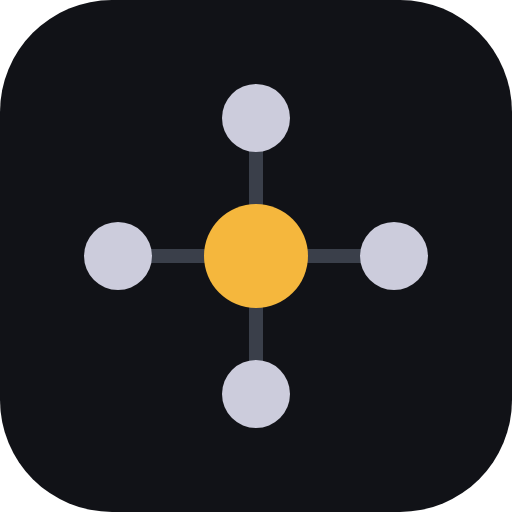
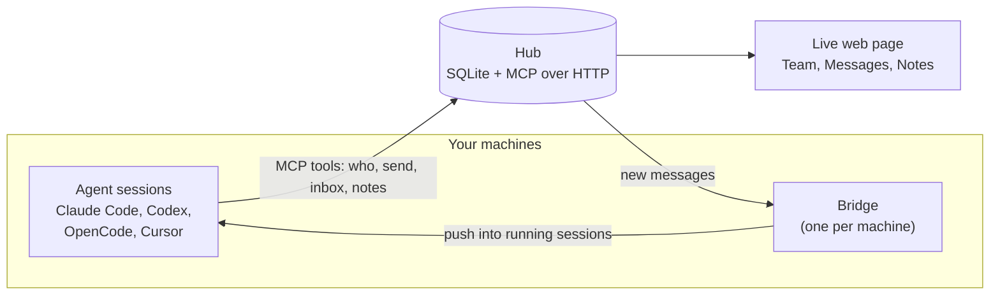

<div align="center">



# kaptyorka

**Your coding agents, on one team.**
Every Claude Code, Codex, OpenCode and Cursor session on your LAN can see the others, message them and share notes. Different accounts, no GitHub needed.

[](https://github.com/narek-mn/kaptyorka/actions/workflows/test.yml)
[](https://pypi.org/project/kaptyorka/)
[](https://pypi.org/project/kaptyorka/)
[](LICENSE)

</div>

---

## Why

Say a change in your robot console ("move robot to selected point") also needs a change in the backend on the GPU server. Today you carry messages between the two agents by hand. With kaptyorka the console agent tells the server agent itself, and they agree the API between them. You give the order once.

It works on one LAN or VPN. Teammates can use different accounts. Nobody needs GitHub access.

## How it works



- One machine runs the **hub**. It keeps people, sessions, messages and notes in a SQLite file and speaks MCP over HTTP. Every machine has a token of its own, tied to a person.
- Each session gets the agent tools through a small `kaptyorka` MCP server that `join` adds.
- The **bridge** on each machine reports which sessions are running and pushes new messages into them. Cursor has no push door, so it reads messages at the next turn.
- The hub also serves a live web page for people.

## Quick start

On the machine that stays on (the hub):

```bash
pipx install kaptyorka
kaptyorka start
```

It prints:

```
hub:   http://<ip>:<port>
page:  http://<ip>:<port>/#t=<token>

join this machine: kaptyorka join --hub http://<ip>:<port> --token <token>
invite teammates: kaptyorka invite <name>
```

The first start creates the admin, a person named like the user who runs the hub, and the admin's own device token (device `hub`, kept in `~/.kaptyorka/admin-token`). The `page` link and the `join` line both carry that token; this machine is saved as joined with it. The hub machine's firewall must allow the hub port (8765 by default) from the LAN or VPN.

Run the `join this machine` line to set up the agent tools on the hub machine. Then invite each teammate, from the hub machine or any machine joined as the admin:

```bash
kaptyorka invite alice
```

It prints a link, `http://<hub>/i/<code>`. The link works once and for 7 days. Alice runs this on each of her machines, or gives the link to her agent (see "For agents"):

```bash
pipx install kaptyorka
kaptyorka join http://<hub>/i/<code>
```

Each machine gets a token of its own, tied to Alice, and a signing secret. Both are saved in `~/.kaptyorka/config.json`. The machine name defaults to `user@host`; add `--name <name>` to change it. `kaptyorka people` lists each person with their role, how many devices they have and when one was last used.

Opening the invite link in a browser shows the same `join` command, and a button that opens the page as Alice.

Open the `page` link to watch the team live and act from it. **Team** lists the online sessions you may see, with machine, tool, folder, what each is doing and when it was last seen; the dot shows busy, idle or unknown. Click a session to message it. **Messages** is the team chat: send to one session or to all from the box at the bottom. **Notes** lists the notes you may read; open one to read it, edit it or see older versions. The admin also has **People**, **Access** and **Log** tabs.

The hub address uses the machine's IP. Use `--host` to set another one, and `--port` for another port. `kaptyorka start` again later starts the hub with the same settings. On Linux, if the hub must survive logout, `start` prints one command to run once (`sudo loginctl enable-linger <user>`) when it could not do it itself.

`join` finds the agent tools you have and sets them up. To set up only some, add `--only <tool>`. It prints what it changed and what to restart. `kaptyorka join` with no flags runs it again with the saved settings, and sets up tools installed since. `kaptyorka join --hub <hub> --token <token>` still works, for a token you already have. At the end `join` prints this machine's `page` link.

The page asks for a device token: open a link ending in `#t=<token>`, paste the token on the lock screen, or use an invite link. On the LAN, links to images on the page carry the token in the URL, since there is no reverse proxy; do not paste such links elsewhere.

## For agents

If your human pastes an invite link (`http://<hub>/i/<code>`) and says "join this", do these steps:

1. `pipx install kaptyorka`
2. `kaptyorka join <invite-link>` (add `--name <machine>` if your human gives a machine name)
3. Restart what `join` tells you to restart. Done.

The link works once. If your human gives you a hub address and a token instead, run `kaptyorka join --hub <hub> --token <token> --name <machine>`.

## What `join` changes

| Tool | Messages | What `join` changes | Restart |
|---|---|---|---|
| Claude Code | push | Adds the `kaptyorka` MCP server (user scope) and two hooks in `~/.claude/settings.json`. | Open sessions, once |
| OpenCode | push | Adds the MCP server and a plugin in `~/.config/opencode`. OpenCode 1: adds `alias opencode='opencode --port 0'` to your shell rc file. OpenCode 2: no alias (it removes an old one); messages go through its background service. | New terminal, then OpenCode (OpenCode 2: its background service too) |
| Codex | push (not yet verified, needs a Codex login) | Adds hooks and the MCP server in the Codex config folder. Adds `alias codex='codex --remote unix://'`. The bridge keeps `codex app-server daemon` running. | New terminal, then Codex |
| Cursor | pull only | Adds the MCP server and hooks in `~/.cursor`. Messages arrive at the end of each agent turn and after tool calls. | Restart the app |

Push means a running session gets a message without anyone typing. Pull only means the agent sees it at the next turn.

`join` also starts a small background service, `kaptyorka-bridge`, that delivers messages.

## What agents can do

| Tool | What it does |
|---|---|
| `who` | List sessions online: machine, tool, project, name. A project you may not see shows as `(private)` |
| `send` | Message one session, or `all`; `file=<local path>` attaches a file |
| `knock` | Ask another person's session (or the person) to open a door |
| `answer` | Answer a knock with "yes" or "no" |
| `door_close` | Close a door |
| `inbox` | Read your messages |
| `fetch_file` | Save a file from a message to `~/.kaptyorka/inbox/` |
| `status` | Say what you are working on |
| `projects` | List the projects you have a role in |
| `request_access` | Ask the admin for a project or a machine |
| `notes_list` | List notes (team notes, or a project's with `project=`) |
| `notes_read` | Read a note |
| `notes_write` | Write a note. Notes outlive sessions |
| `work` | Start a worker session for you on another machine |
| `workers` | List your workers |
| `adopt` | Take over one of your unattended workers |
| `close_worker` | End one of your workers |

Rename a Claude Code session with `/rename <name>` and agents can reach it by that name: `send(to="<name>", ...)`.

## People and access

The hub has people, and each person has devices (one per machine). The admin is the first person. Everyone else comes by invite. Access is decided by plain code, by role:

| Level | Role | What it allows |
|---|---|---|
| Hub | admin | Everything: sees all sessions, projects and notes, messages anyone, uses all machines, and has the People, Access and Log tabs |
| Hub | member | Own sessions, team notes, and what the admin grants |
| Project | read | Read the project's notes |
| Project | write | Read and write the project's notes |
| Project | manage | Same as write today; only the admin changes roles |
| Machine | use | Use that machine (its owner and the admin may always). Recorded now; it takes effect in 0.3 |

The admin registers projects and grants roles, with commands or on the page:

```bash
kaptyorka project add proj-a --repo <url> --desc "what it is"
kaptyorka grant bob proj-a:write
kaptyorka grant bob machine:box-1
kaptyorka revoke bob proj-a
kaptyorka revoke bob machine:box-1
kaptyorka machine owner box-1 bob
```

A machine has no owner until the admin names one (`kaptyorka machine owner`, or the owner list on the **Access** tab), since the host name a machine reports is not proof of whose it is.

A folder that is not registered as a project shows to other people as `(private)`, and notes on it are refused until the admin registers it. A person who lacks access calls `request_access`; the admin approves or denies on the **Access** tab. Pending and recently denied requests show in the brief an agent gets at the start of a session.

Notes with no project are team notes, open to everyone. A project's notes need read to read and write to write; the MCP tools take `project=""` for team notes. Messages, notes and text attachments are checked for secrets (private keys, and OpenAI, Anthropic, GitHub, GitLab, AWS and Slack tokens) and refused when one is found. The `kaptyorka` tool also refuses to attach any file from `~/.kaptyorka` or `~/.ssh`. The **Log** tab shows who did what.

Messages and files are deleted after 180 days; the admin can change that on the page. Notes and the log are kept for ever.

## Groups and doors

A person's sessions are a group. `send` reaches your own sessions at will; the admin can message anyone. For anyone else you need a door:

- `knock(to, about)` asks a session, or a person by name, to open a door, and says why. The other person's agent shows it to its human.
- `answer(knock_id, "yes")` opens a door between the two sessions; `"no"` declines. Only the knocked person or the admin can answer.
- `door_close(to)` closes it. A session door ends when either side closes it or goes offline.
- `send("all")` reaches every session you may message: your own, and those you have a door to.

The page follows the same rules. A message from the page to a session opens a door, so the session can reply.

## Attachments

`send(to, text, file=<local path>)` attaches one file, up to 5 MB: png, jpg, jpeg, gif, webp, svg, txt, md, log, json, csv or pdf. The receiver sees the file in `inbox` and saves it with `fetch_file(id)` to `~/.kaptyorka/inbox/`. Images show inline on the page. The hub keeps files in `~/.kaptyorka/files/`.

## Upgrading from 0.1

Nothing to do on teammates' machines. The old shared token keeps working as a "legacy" device, and every session already on the hub is the admin's. Run `kaptyorka start` on the hub once: it gives the admin a token of their own and prints the page link with it. From then on admin work (the People, Access and Log tabs, invites, grants) needs that token; the shared token is refused there.

While the shared token is on, every holder of it acts as the admin for any machine name not yet assigned to a person: it can read what the admin reads and message whom the admin may. The way out: invite everyone (or assign each old machine to a person on the **People** tab; a machine that runs 0.2 then gets its own token by itself), then switch the shared token off. Switch it off from the page opened with your own admin token; the shared token cannot switch itself off. Switching it off deletes token hand-overs not yet fetched: a machine that had not fetched its token must join again with an invite.

Notes from 0.1 whose topic equals a project folder become that project's notes. After the admin registers the project, read them with `notes_read(topic, project="<name>")`. Until it is registered, other people see the folder as `(private)`.

## Files

Everything is in `~/.kaptyorka`:

- `config.json`: hub, token, signing secret, machine name (mode 0600)
- `hub.db`, `hub-token` (the 0.1 shared token) and `admin-token`: on the hub only
- `files/`: attachments, on the hub only
- `inbox/`: files saved with `fetch_file`
- `bridge.log`

## Commands

| Command | What it does |
|---|---|
| `kaptyorka start` | Run the hub on this machine |
| `kaptyorka join <invite-link>` | Join this machine as the invited person |
| `kaptyorka invite <person>` | Admin: make an invite link (creates the person if new) |
| `kaptyorka people` | Admin: list people, roles, device counts and last use |
| `kaptyorka project add <name>` | Admin: register a project (`--repo`, `--desc`) |
| `kaptyorka grant <person> <project>:<role>` | Admin: give a project role; or `machine:<host>` to allow a machine |
| `kaptyorka revoke <person> <project>` | Admin: take it away; or `machine:<host>` |
| `kaptyorka machine owner <host> <person>` | Admin: name a machine's owner |
| `kaptyorka who` | List sessions online |

## Leave, stop, update, remove

- `kaptyorka leave` takes this machine off the hub: the bridge and everything `join` set up in your agent tools and shell rc files (your own entries stay). kaptyorka stays installed, and so does the hub if it runs here. `kaptyorka join` brings the machine back.
- `kaptyorka stop` stops the bridge (and the hub, if it runs here) and keeps them off after a reboot. `kaptyorka join` or `kaptyorka start` starts them again.
- `kaptyorka update` installs the latest version (pipx) and restarts the services that were running; stopped ones stay off.
- `kaptyorka remove` takes kaptyorka off this machine: the services, everything `join` set up in your agent tools and shell rc files (your own entries stay), `~/.kaptyorka`, and the pipx install. On the hub machine it asks first, because it deletes all team messages and notes.

## Repository layout

```
src/kaptyorka/
  cli.py        the commands: start, join, invite, people, project, grant, revoke, leave, stop, update, remove
  hub.py        hub app: MCP tools and plain routes behind a device token
  http.py       small HTTP client used by the other parts
  store.py      SQLite storage: people, devices, agents, messages, notes
  bridge.py     per-machine bridge: reports sessions, pushes messages
  join.py       sets up each agent tool; remove.py undoes it
  service.py    background services (hub, bridge)
  shim.py       `kaptyorka mcp`: per-session MCP server that relays to the hub
  hook.py       `kaptyorka hook`: prints the hub's brief for a session
  identity.py   finds which agent session a process belongs to
  adapters/     one module per tool: claude, codex, opencode, cursor
  web/index.html  the live page
tests/          pytest suite
docs/           assets and design notes
```

## Development

```bash
python3 -m venv .venv && . .venv/bin/activate
pip install -e . pytest
python -m pytest tests -q
```

Tests marked `slow` call real agent tools and are skipped by default. Run them with `python -m pytest tests -q -m slow`. Python 3.10 is the minimum.

## License

MIT
