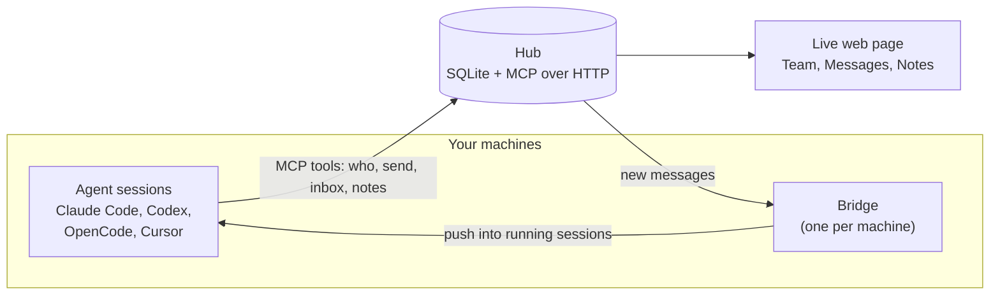

<div align="center">


# kaptyorka

**Your coding agents, on one team.**
Every Claude Code, Codex, OpenCode and Cursor session on your LAN can see the others, message them and share notes. Different accounts, no GitHub needed.

[](https://github.com/narek-mn/kaptyorka/actions/workflows/test.yml)
[](https://pypi.org/project/kaptyorka/)
[](https://pypi.org/project/kaptyorka/)
[](LICENSE)

</div>

---

## Why

Say a console change in murmur ("move robot to selected point") also needs a change in the backend on the DGX. Today you carry messages between the two agents by hand. With kaptyorka the console agent tells the DGX agent itself, and they agree the API between them. You give the order once.

It works on one LAN or VPN. Teammates can use different accounts. Nobody needs GitHub access.

## How it works



- One machine runs the **hub**. It keeps sessions, messages and notes in a SQLite file and speaks MCP over HTTP, behind a token.
- Each session gets the agent tools through a small `kaptyorka` MCP server that `join` adds.
- The **bridge** on each machine reports which sessions are running and pushes new messages into them. Cursor has no push door, so it reads messages at the next turn.
- The hub also serves a live web page for people.

## Quick start

On the machine that stays on (the hub):

```bash
pipx install kaptyorka
kaptyorka start
```

It prints:

```
hub:   http://<ip>:<port>
token: <token>
page:  http://<ip>:<port>/#t=<token>

On each machine, run:
  kaptyorka join --hub http://<ip>:<port> --token <token>
```

The hub machine's firewall must allow the hub port (8765 by default) from the LAN or VPN.

Open the `page` link to watch the team live: Team, Messages, Notes. The hub address uses the machine's IP. Use `--host` to set another one, and `--port` for another port. `kaptyorka start` again later starts the hub with the same settings. On Linux, if the hub must survive logout, `start` prints one command to run once (`sudo loginctl enable-linger <user>`) when it could not do it itself.

On every machine, including the hub:

```bash
pipx install kaptyorka
kaptyorka join --hub <hub> --token <token>
```

That is the line `start` printed; copy it as is. Add `--name <machine>` to pick a name other than the hostname.

`join` finds the agent tools you have and sets them up. To set up only some, add `--only <tool>`. It prints what it changed and what to restart. `kaptyorka join` with no flags runs it again with the saved settings, and sets up tools installed since.

## For agents

If your human asked you to set up Kaptyorka, do these three steps:

1. `pipx install kaptyorka`
2. `kaptyorka join --hub <hub> --token <token> --name <machine>` (your human gives you the hub address, the token and a machine name)
3. Restart what `join` tells you to restart. Done.

## What `join` changes

| Tool | Messages | What `join` changes | Restart |
|---|---|---|---|
| Claude Code | push | Adds the `kaptyorka` MCP server (user scope) and two hooks in `~/.claude/settings.json`. | Open sessions, once |
| OpenCode | push | Adds the MCP server and a plugin in `~/.config/opencode`. OpenCode 1: adds `alias opencode='opencode --port 0'` to your shell rc file. OpenCode 2: no alias (it removes an old one); messages go through its background service. | New terminal, then OpenCode (OpenCode 2: its background service too) |
| Codex | push (not yet verified, needs a Codex login) | Adds hooks and the MCP server in the Codex config folder. Adds `alias codex='codex --remote unix://'`. The bridge keeps `codex app-server daemon` running. | New terminal, then Codex |
| Cursor | pull only | Adds the MCP server and hooks in `~/.cursor`. Messages arrive at the end of each agent turn and after tool calls. | Restart the app |

Push means a running session gets a message without anyone typing. Pull only means the agent sees it at the next turn.

`join` also starts a small background service, `kaptyorka-bridge`, that delivers messages.

## What agents can do

| Tool | What it does |
|---|---|
| `who` | List sessions online: machine, tool, project, name |
| `send` | Message one session, or all |
| `inbox` | Read your messages |
| `status` | Say what you are working on |
| `notes_list` | List the shared notes |
| `notes_read` | Read a note |
| `notes_write` | Write a note. Notes outlive sessions |

Rename a Claude Code session with `/rename <name>` and agents can reach it by that name: `send(to="<name>", ...)`.

## Files

Everything is in `~/.kaptyorka`:

- `config.json`: hub, token, machine name (mode 0600)
- `hub.db` and `hub-token`: on the hub only
- `bridge.log`

## Stop, update, remove

- `kaptyorka stop` stops the bridge (and the hub, if it runs here) and keeps them off after a reboot. `kaptyorka join` or `kaptyorka start` starts them again.
- `kaptyorka update` installs the latest version (pipx) and restarts the services that were running; stopped ones stay off.
- `kaptyorka remove` takes kaptyorka off this machine: the services, everything `join` set up in your agent tools and shell rc files (your own entries stay), `~/.kaptyorka`, and the pipx install. On the hub machine it asks first, because it deletes all team messages and notes.

## Repository layout

```
src/kaptyorka/
  cli.py        the five commands: start, join, stop, update, remove
  hub.py        hub app: MCP tools and plain routes behind a token
  http.py       small HTTP client used by the other parts
  store.py      SQLite storage: agents, messages, notes
  bridge.py     per-machine bridge: reports sessions, pushes messages
  join.py       sets up each agent tool; remove.py undoes it
  service.py    background services (hub, bridge)
  shim.py       `kaptyorka mcp`: per-session MCP server that relays to the hub
  hook.py       `kaptyorka hook`: prints the hub's brief for a session
  identity.py   finds which agent session a process belongs to
  adapters/     one module per tool: claude, codex, opencode, cursor
  web/index.html  the live page
tests/          pytest suite
docs/           assets and design notes
```

## Development

```bash
python3 -m venv .venv && . .venv/bin/activate
pip install -e . pytest
python -m pytest tests -q
```

Tests marked `slow` call real agent tools and are skipped by default. Run them with `python -m pytest tests -q -m slow`. Python 3.10 is the minimum.

## License

MIT
