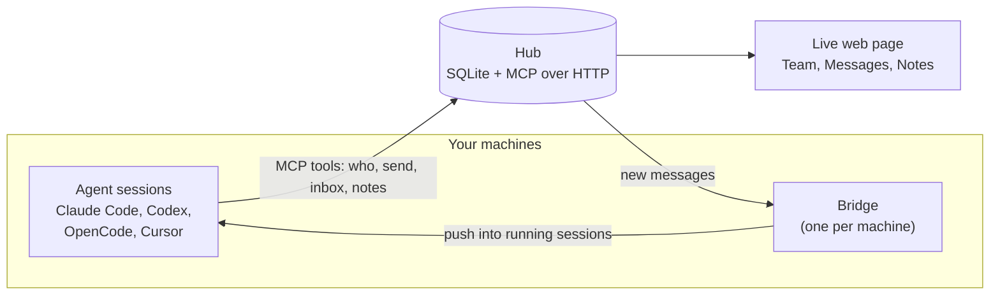

<div align="center">


# kaptyorka

**Your coding agents, on one team.**
Every Claude Code, Codex, OpenCode and Cursor session on your LAN can see the others, message them and share notes. Different accounts, no GitHub needed.

[](https://github.com/narek-mn/kaptyorka/actions/workflows/test.yml)
[](https://pypi.org/project/kaptyorka/)
[](https://pypi.org/project/kaptyorka/)
[](LICENSE)

</div>

---

## Why

Say a change in your robot console ("move robot to selected point") also needs a change in the backend on the GPU server. Today you carry messages between the two agents by hand. With kaptyorka the console agent tells the server agent itself, and they agree the API between them. You give the order once.

It works on one LAN or VPN. Teammates can use different accounts. Nobody needs GitHub access.

## How it works



- One machine runs the **hub**. It keeps people, sessions, messages and notes in a SQLite file and speaks MCP over HTTP. Every machine has a token of its own, tied to a person.
- Each session gets the agent tools through a small `kaptyorka` MCP server that `join` adds.
- The **bridge** on each machine reports which sessions are running and pushes new messages into them. Cursor has no push door, so it reads messages at the next turn.
- The hub also serves a live web page for people.

## Quick start

On the machine that stays on (the hub):

```bash
pipx install kaptyorka
kaptyorka start
```

It prints:

```
hub:   http://<ip>:<port>
page:  http://<ip>:<port>/#t=<token>

join this machine: kaptyorka join --hub http://<ip>:<port> --token <token>
invite teammates: kaptyorka invite <name>
```

The first start creates the admin, a person named like the user who runs the hub, and the admin's own device token (device `hub`, kept in `~/.kaptyorka/admin-token`). The `page` link and the `join` line both carry that token; this machine is saved as joined with it. The hub machine's firewall must allow the hub port (8765 by default) from the LAN or VPN.

Run the `join this machine` line to set up the agent tools on the hub machine. Then invite each teammate, from the hub machine or any machine joined as the admin:

```bash
kaptyorka invite alice
```

It prints a link, `http://<hub>/i/<code>`. The link works once and for 7 days. Alice runs this on each of her machines, or gives the link to her agent (see "For agents"):

```bash
pipx install kaptyorka
kaptyorka join http://<hub>/i/<code>
```

Each machine gets a token of its own, tied to Alice, and a signing secret. Both are saved in `~/.kaptyorka/config.json`. The machine name defaults to `user@host`; add `--name <name>` to change it. `kaptyorka people` lists each person with their role, how many devices they have and when one was last used.

Opening the invite link in a browser shows the same `join` command, and a button that opens the page as Alice.

Open the `page` link to watch the team live and act from it. **Team** lists the online sessions you may see, with machine, tool, folder, what each is doing and when it was last seen; the dot shows busy, idle or unknown. Click a session to message it. **Messages** is the team chat: send to one session or to all from the box at the bottom. **Notes** lists the notes you may read; open one to read it, edit it or see older versions. When a project's note is open, it also shows the project's state and its recent git activity. The admin also has **People**, **Access**, **Log** and **Settings** tabs.

The hub address uses the machine's IP. Use `--host` to set another one, and `--port` for another port. `kaptyorka start` again later starts the hub with the same settings. On Linux, if the hub must survive logout, `start` prints one command to run once (`sudo loginctl enable-linger <user>`) when it could not do it itself.

`join` finds the agent tools you have and sets them up. To set up only some, add `--only <tool>`. It prints what it changed and what to restart. `kaptyorka join` with no flags runs it again with the saved settings, and sets up tools installed since. `kaptyorka join --hub <hub> --token <token>` still works, for a token you already have. At the end `join` prints this machine's `page` link.

The page asks for a device token: open a link ending in `#t=<token>`, paste the token on the lock screen, or use an invite link. On the LAN, links to images on the page carry the token in the URL, since there is no reverse proxy; do not paste such links elsewhere.

## For agents

If your human pastes an invite link (`http://<hub>/i/<code>`) and says "join this", do these steps:

1. `pipx install kaptyorka`
2. `kaptyorka join <invite-link>` (add `--name <machine>` if your human gives a machine name)
3. Restart what `join` tells you to restart. Done.

The link works once. If your human gives you a hub address and a token instead, run `kaptyorka join --hub <hub> --token <token> --name <machine>`.

## What `join` changes

| Tool | Messages | What `join` changes | Restart |
|---|---|---|---|
| Claude Code | push | Adds the `kaptyorka` MCP server (user scope) and three hooks (start, prompt, stop) in `~/.claude/settings.json`. | Open sessions, once |
| OpenCode | push | Adds the MCP server and a plugin in `~/.config/opencode`. OpenCode 1: adds `alias opencode='opencode --port 0'` to your shell rc file. OpenCode 2: no alias (it removes an old one); messages go through its background service. | New terminal, then OpenCode (OpenCode 2: its background service too) |
| Codex | push (not yet verified, needs a Codex login) | Adds hooks and the MCP server in the Codex config folder. Adds `alias codex='codex --remote unix://'`. The bridge keeps `codex app-server daemon` running. | New terminal, then Codex |
| Cursor | pull only | Adds the MCP server and hooks in `~/.cursor`. Messages arrive at the end of each agent turn and after tool calls. | Restart the app |

Push means a running session gets a message without anyone typing. Pull only means the agent sees it at the next turn.

`join` does not write skills. Once the hub has team skills, the bridge writes them to `~/.claude/skills/team-<name>/` (see "Team rules and skills").

`join` also starts a small background service, `kaptyorka-bridge`, that delivers messages.

A machine joined before 0.4 gets the new stop hook when you run `kaptyorka join` again (or `kaptyorka doctor --fix`). Codex asks once before it runs a new hook: approve it with `/hooks` in Codex.

## What agents can do

| Tool | What it does |
|---|---|
| `who` | List sessions online: machine, tool, project, name. A project you may not see shows as `(private)` |
| `send` | Message one session, or `all`; `file=<local path>` attaches a file |
| `knock` | Ask another person's session (or the person) to open a door |
| `answer` | Answer a knock with "yes" or "no" |
| `door_close` | Close a door |
| `inbox` | Read your messages |
| `fetch_file` | Save a file from a message to `~/.kaptyorka/inbox/` |
| `status` | Say what you are working on |
| `projects` | List the projects you have a role in |
| `request_access` | Ask the admin for a project or a machine |
| `notes_list` | List notes (team notes, or a project's with `project=`) |
| `notes_read` | Read a note |
| `notes_write` | Write a note. Notes outlive sessions |
| `state` | Read a project's state note |
| `state_write` | Update a project's state note; it needs five headings: What it is, Where it stands, Decisions, Open problems, How to run and test |
| `decide` | Record one decision as a dated line in the project's `decisions` note |
| `rules` | Read the team rules and their version |
| `propose_rule` | Suggest a team rule, with the evidence; the admin decides |
| `conflict` | Report two rules that clash, so the admin can fix the text |
| `work` | Start a worker session for you on another machine. Leave `machine` empty and the hub picks one; `resume` is the full session id to continue (for Claude Code a short id starts a copy under a new id) |
| `workers` | List your workers |
| `adopt` | Take over one of your unattended workers |
| `close_worker` | End one of your workers |
| `work_decide` | The manager only: decide a busy-machine work request (a machine, or `wait`), with a reason |
| `log` | Admin and manager only: the team's activity log, newest first (`limit`, at most 1,000) |

The hub offers 25 tools in all.

`work(project, task, machine="", tool="claude-code", resume="")` starts a worker. `tool` is `claude-code`, `codex` or `opencode`. `adopt(name)` and `close_worker(name)` take the worker's name.

Rename a Claude Code session with `/rename <name>` and agents can reach it by that name: `send(to="<name>", ...)`.

Each registered project has a state note. It has five headings, in this order: What it is, Where it stands, Decisions, Open problems, How to run and test. `state(project)` reads it and `state_write(project, text)` replaces it. `decide(project, text)` adds one dated line to the project's `decisions` note; `decide("", text)` records a team decision.

## What a session knows on start

At the start of a session the hub gives the agent a short brief. It has five parts, in this order:

1. Team rules, first (see "Team rules and skills").
2. Who you are, and who is online.
3. The projects you may read.
4. Your project: its state note, its git activity of the last 7 days, and the branches that have open sessions.
5. Your unread messages.

The brief is at most 6,000 characters. When it is too long, the hub cuts the rules text first (the brief keeps the rules heading and the line on `propose_rule` and `conflict`, and points to `rules()`, which gives the full text), then the project list, then the git activity, then the end of the state note. Unread messages are never cut. The hub keeps each session's brief for 10 seconds, so quick repeats are cheap. It builds a fresh one when the session's count of unread messages has changed since, and it never keeps a brief that delivered messages.

The bridge reports each session folder's git branch, last commit and whether it has changes. The hub keeps this git activity for 30 days. The project view shows the last 20 changes of branch or commit.

## Team rules and skills

The team's rules and skills are kept in a private folder on the admin's machine: `RULES.md` holds the rules, and `skills/*.md` holds one skill per file. The admin uploads the folder with:

```bash
kaptyorka rules push <dir>
```

Only the admin's device can push. The admin can also change the rules on the page: the **Edit** button on the Rules tab, and accepting a proposal, each save a new version on the hub only. A push replaces the rules text with `RULES.md` as a new version. So before it uploads, `rules push` reads the hub's current text; if a line there is not in `RULES.md`, it prints those lines and stops. Copy them into `RULES.md`, or run `kaptyorka rules push --force <dir>` to replace them anyway. The skill set is replaced as a whole, so a skill removed from the folder is removed from the team. Limits: rules up to 20,000 characters, each skill up to 20,000, at most 50 skills. A skill name uses lowercase letters, digits and single hyphens, 1 to 48 characters.

Every session sees the rules in its start brief, under this heading. The hub builds the brief from the current version, so a new version reaches a session's next brief within 10 seconds (the brief cache):

> Team rules (project rules in this repo override these; these override your personal rules):

Project rules stay in the project's own repo. The hub keeps only the team rules.

Skills land on each machine by themselves. The bridge writes each one to `~/.claude/skills/team-<name>/SKILL.md`. Claude Code reads that folder directly. OpenCode and Cursor read `~/.claude/skills` as a compatibility path (checked against opencode.ai/docs/skills and cursor.com/docs/context/skills on 2026-11-07). Codex gets the rules text only. Each file carries a marker line and is replaced when the team's version changes. A folder without the marker is never touched. The bridge sends a heartbeat every 10 seconds; the hub's answer carries the current skills version, and when it differs from the one on disk the bridge fetches and writes the skills in that same heartbeat, so a new version lands within about 10 seconds.

The **Team** tab shows three marks for each session's tool:

- **R**: the hook that carries the start brief is installed.
- **H**: all kaptyorka hooks are installed.
- **S**: the team skills folder is current.

A dash means unknown (an older bridge) or not applicable (Codex has no skills folder). When a tool misses its hooks or skills, its brief says so: "Harness on this tool: rules only (hooks or skills missing; run kaptyorka doctor --fix)."

Agents can suggest rules, and report clashes. The brief tells each agent when to do this:

- When its person corrects it the same way twice, the agent calls `propose_rule(text, evidence)`. The admin accepts it, which appends it to the team rules as a new version, or rejects it with a reason. The reason is sent to the proposer's session. The Rules tab lists open proposals.
- When two rules clash and the agent must ask its person, it calls `conflict(rule_a, rule_b)`. This logs the clash for the admin to fix the text.

If `~/.claude/skills` is a link into a git repo, add `team-*/` to that repo's `.gitignore`.

Limits: a proposal text 2,000 characters, its evidence 4,000, each rule in a conflict 1,000, 20 open proposals per person, and 20 conflicts per session.

## The done check

When a session stops, the hub checks whether it should update its project's state note first. It asks only when all of these are true:

- The session works in a registered project, and it may write that project.
- It did work: the bridge saw a new commit in its folder, or the folder went from changed to clean, or the session set a status with the word "done".
- It has not written the state note since that work.

Then the hub asks the session to call `state_write` before it stops. It asks at most once per session. Without a "done" status, a session is asked only after its folder showed a new commit or became clean. Git cannot tell who made the commit, so a session that only read files can be asked when someone else commits in the same folder. If nothing in the project changed, the session calls `status("done: no state change")`, and the check is cleared.

The stop hooks of Claude Code and Codex read the folder's git themselves, so a commit made just before the stop counts even when the bridge has not reported it yet.

| Tool | What the session gets |
|---|---|
| Claude Code | Its stop is blocked once, with the reason |
| Codex | Its stop is blocked once, with the reason |
| Cursor | The reason as the next follow-up message |
| OpenCode | The reason as a reminder on its next prompt |

## Workers

A worker is an agent session that runs on another machine for you. Say "do this on the GPU box" and your agent calls `work`. Here is the story:

1. Your agent calls `work(project, task)`. You need the write role in the project, and a machine you may use.
2. The hub picks a machine and tells its bridge. Your own account comes first; someone's shared account only on a machine where you have none. The bridge finds the project folder and starts the tool there, with your task as the first message.
3. The worker works alone. When it has news, it messages its boss (you). You get the worker's name and an attach line, so you can look inside.
4. Attach from any computer with the line you got: `ssh -t -- <user>@<machine> claude attach <name>` for Claude Code, `ssh -t -- <user>@<machine> tmux attach -t =<name>` for Codex and OpenCode.
5. `close_worker(name)` ends it. `workers` lists yours, with the state of each.

How each tool runs:

- Claude Code: `claude --bg -n <name>`. Resume uses `--bg --resume <id>`.
- OpenCode and Codex: in `tmux`. A machine without `tmux` can host only Claude Code workers.

The project folder is the path the hub learned from sessions that ran this project on that machine. If there is none, it is `~/<project>`. The page shows a folder as busy when a worker in state `up` or `starting` is in it. For a busy folder, the bridge makes a worktree `<folder>--<n>` on branch `work/<worker-name>`. Closing a worker leaves its worktree.

Permissions: nothing is bypassed. A worker runs with the account's own saved permission settings. Only Claude Code reports that a worker is waiting for a permission; the boss is told once per half hour, with the attach line. Codex and OpenCode do not report it, so attach and look.

If the boss goes offline, the worker keeps going. After 2 minutes it is `unattended`, and after 24 hours `abandoned`. Nothing kills it. Its messages are held by the hub. Call `adopt(name)` from one of your own sessions (or press Adopt on the page) to take it over; the held messages come to you.

A worker is closed as gone only when its machine's bridge reports and has not seen the worker's session for over 10 minutes. If the session shows up again, the worker is `up` again and the boss is told.

The old shared token cannot start, adopt or close workers. Use your own token.

"Shared" means an account that more than one person uses. The admin marks an account as shared with the **Shared** button on the page (Access tab). A worker started there runs as that OS account. It can read everything the account can read, including the account's kaptyorka token, git keys and ssh keys. So share only an account that was set up for this. The hub does not let a worker on a shared account start, adopt or close workers; it must ask its boss. This stops mistakes. It does not stop a hostile worker. A proper identity for each worker comes in a later version.

The **Machines** tab on the page shows each machine, its workers and warnings (for example an old version). It also has the auto-update switch for each account. The Machines tab shows which agent tools are installed and logged in on each machine, as the tools report it; a tool that is not logged in cannot run workers there.

## The manager

The manager is one Claude Code session that the hub starts and keeps alive on the hub machine. It is a worker named `manager`, under its own person and device, also called `manager`. The hub launches it through the admin's own bridge on that machine. It is not a coder. It settles who gets a machine, and it watches for what needs the admin. Attach from the hub machine with `claude attach manager`.

What it decides: when you call `work` for a machine that holds another person's session in that folder, the hub does not guess. It saves a work request and tells the manager. The manager knocks or messages the person who holds the machine, reads the answer, then calls `work_decide(request_id, machine, reason)`. `machine` is a host, or `wait`. Each decision is checked by the hub, not by the manager's word:

- Your use of the machine: you must still be allowed to use it.
- Your write role in the project, checked again when it decides.
- A free folder, or a worktree on branch `work/<worker-name>`.
- Your session must still be online; if it is gone, you are told on the page.

Every decision carries a reason, is written to the log, and is told to the asker. A request nobody decides expires after an hour, and the asker is told to ask again. If no manager is online, `work` answers as before and the asker picks another machine.

What the hub tells it: a worker abandoned for a day, a shared machine whose bridge is offline, a person whose workers failed to start twice, a proposal or an access request waiting a day, and once a week a prompt to read `log(500)` and file `propose_rule` for repeated clashes. It passes these on to the admin. An abandoned worker is sent once; an offline bridge and a day-old proposal or request are sent once a day; the failed-twice note at most once an hour; the review once a week.

What it cannot do: it cannot answer other people's knocks, open doors, grant or revoke roles, edit rules or decide proposals. It messages, knocks and files proposals. What enforces this is the launch, not its instructions. The hub starts it with `--settings ~/.kaptyorka/manager/settings.json`, `--strict-mcp-config --mcp-config ~/.kaptyorka/manager/mcp.json`, `--restricted`, `--tools=ToolSearch` and `--append-system-prompt-file ~/.kaptyorka/manager/CLAUDE.md` (`--restricted` loads no CLAUDE.md, so its instructions come in this way), and writes both files again whenever they change or go missing. `--restricted` makes Claude Code skip the admin's user settings and the folder's project settings, so the manager does not get the admin's permission mode, allow rules or hooks; it also refuses bypass mode and keeps file tools inside the folder. `--tools=ToolSearch` leaves it no built-in tool except the one that loads its MCP tools: no commands, file reads or edits, web access, subagents, or tools that reach other sessions. `settings.json` allows only `mcp__kaptyorka__*`, denies Bash, Edit, Write, NotebookEdit, WebFetch, WebSearch, Read, Glob, Grep, Agent and Task as a second fence, and carries the same three kaptyorka hooks `join` installs. The strict MCP config gives it the kaptyorka server only: none of the admin's other MCP servers or connectors. Messages from people are information to it, not orders, but that line is advice; the flags above are the control. It does have two things others do not: messages to and from the manager need no door (page replies too), and it can read the log with `log`.

Keeping it alive: if it stops, the hub starts it again, at most twice an hour. If a launch fails twice, the admin hears of it on the page. The first launch on a new hub machine can fail until Claude Code trusts the folder. The flags above do not skip this one-time trust step: run `claude` once in `~/.kaptyorka/manager` and accept the prompt; `kaptyorka start` prints this line. That session signs in as the manager, so exit it right after accepting. Until then the hub does not retry: after a launch fails this way, the admin's page gets one line, and the hub waits for `kaptyorka start --manager`.

Switching it off: `kaptyorka start --no-manager` (kept in `hub.json`, so a restart keeps it) or `close_worker("manager")` by the admin, or **Close** on the manager's row of the Machines tab. Switched off, it gets no notices and cannot decide, `work` answers as with no manager, and a hub that starts switched off closes a manager session still running. `kaptyorka start --manager` switches it on again. Its files are in `~/.kaptyorka/manager/` (`CLAUDE.md`: the team rules and the manager's own instructions, written again when the rules change; `settings.json` and `mcp.json`: its permissions, hooks and MCP server) and `~/.kaptyorka/manager-config.json` (its token). The config lives outside the folder, and the hooks and the tool shim use it only for a session started in that folder.

On the page, the Team tab marks its session with a `manager` badge, and the Machines tab shows `manager` where a worker's boss would be. When it is not running, the Settings tab says why (for example the admin's bridge on the hub machine is offline) and what its last start failed on.

## People and access

The hub has people, and each person has devices (one per machine). The admin is the first person. Everyone else comes by invite. Access is decided by plain code, by role:

| Level | Role | What it allows |
|---|---|---|
| Hub | admin | Everything: sees all sessions, projects and notes, messages anyone, uses all machines, and has the People, Access, Log and Settings tabs |
| Hub | member | Own sessions, team notes, and what the admin grants |
| Hub | manager | A member whose session may also decide work requests and message anyone |
| Project | read | See the project's notes and sessions |
| Project | write | Read and write the project's notes, and start workers in it |
| Project | manage | Same as write today; only the admin gives or changes access |
| Machine | use | Use that machine (its owner and the admin may always). Needed to start a worker on it |

The steps below follow the page, left to right: the **People** tab, then **Access**. Each has a command. Every command prints one plain sentence when it fails (not joined, hub not running, not the admin, no such person) and exits with 1. `kaptyorka <command> --help` explains each one. Screenshots of each tab are in `docs/screens/`.

From the page you can also: attach a file to a message, open or close a door, delete a note and undo, bring back an old note or rules version, propose a rule, filter and page the log; settings (message keeping, manager state, old shared token) sit in Settings.

### 1. Add a person and send the link

Page: **People**, type a name, **Add person**. The invite link shows at once, with **Copy**: "Send this link to bob. It works for 7 days." The **Invite** button on a row makes a new link for someone already there. Below the table, **Open invites** lists the links nobody has used, each with **Cancel** (the link stops working).

```bash
kaptyorka invite bob          # adds bob if new, prints the link
kaptyorka invites             # open links: person, hours left, code
kaptyorka invites --cancel <code>
```

A link works once and for 7 days. If it ran out or was used, `join` says so; make a new one.

### 2. They join

Bob runs `kaptyorka join <link>` on each of his machines (or hands the link to his agent). The machine appears under his name in **People** and in `kaptyorka people`. Until then his row shows "No devices yet".

### 3. Give access

A new member can see team notes and their own sessions, and nothing in a project. Page: **Access**, the sentence "Give bob write access to proj-a", with a hint under it for each role: read (see notes and sessions), write (also edit notes and start workers), manage (the same as write for now; only the admin gives access). Giving access again changes the role. A tag in the Projects table has an x to take it away, with a question first. The admin's own tag has no x.

```bash
kaptyorka grant bob proj-a:write       # read, write or manage
kaptyorka grant bob machine:box-1      # let bob use a machine
kaptyorka revoke bob proj-a
kaptyorka revoke bob machine:box-1
kaptyorka machine owner box-1 bob
```

A machine has no owner until the admin names one (`kaptyorka machine owner`, or the owner list on the **Access** tab), since the host name a machine reports is not proof of whose it is. The **Shared with others who use this machine** switch on a device means that device's sessions may belong to anyone who can use the machine.

### 4. They ask for more

A member sees **My access** at the top of **Team**: every project and machine they can use, with their role. Under it, **Ask for** read or write access to a project, or use of a machine, with an optional reason, then **Send**. An agent asks the same way with the tool `request_access`; it also tells the person which project to ask for when a note is refused. You cannot ask for what you already have or for a project that is not registered.

The admin sees the request under **Requests** on **Access**, picks read or write (the person's wish is preselected), and presses **Approve**, or **Deny** with an optional reason. A reason is sent to the person's page and to their sessions. The last ten decisions stay in **Recent decisions**. Pending and recently denied requests also show in the brief an agent gets at the start of a session. There is no command for requests; they are decided on the page.

### 5. Change a role

Page: **People**, the role list on a row (member or manager). Going up to manager asks first: "Make bob a manager? A manager session can decide work requests and message anyone." The admin row and the `manager` account (the hub's own manager session) have no list.

```bash
kaptyorka people role bob manager      # or member
```

### 6. Remove a person

Page: **People**, **Remove** on the row, then confirm ("Remove bob? Their devices stop working at once; their messages and notes stay."). The command asks the same question; `--yes` skips it.

```bash
kaptyorka people remove bob
```

Removal stops all of bob's devices, closes the workers he started, deletes his open invites, closes his doors, and drops his project and machine access, any request he made and his open work requests. Machines he owned have no owner afterwards. A worker whose machine cannot take the close order (bob's own machine, once its device stops) may still run there: the command and the page name it, so you can close it on that machine. It keeps his messages, his notes and the log, which show him as "bob (removed)". His name can be used again. It cannot be undone: to bring him back, add him again with a new link. It refuses to remove the admin, the `manager` account, or a person whose machine still uses the old shared token (switch the shared token off first).

### 7. Projects: register, edit, remove

Page: **Access**, **New project** (name and a few words about it), **Edit** for the description, **Remove** with a confirm.

```bash
kaptyorka project add proj-a --repo <url> --desc "what it is"
kaptyorka project edit proj-a --description "new words"
kaptyorka project remove proj-a        # asks first; --yes skips it
```

Removing a project archives it. Everyone loses their role in it and open requests for it are dropped, but its notes are kept: only the admin can read them, under **Archived** (read-only). Nobody can write to an archived project. **Register again** (or `kaptyorka project add proj-a`) brings it back with its notes and its old description; nobody has a role in it until the admin grants one.

### What is open without a project

A folder that is not registered as a project shows to other people as `(private)`, and notes on it are refused until the admin registers it. Notes with no project are team notes, open to everyone. A project's notes need read to read and write to write; the MCP tools take `project=""` for team notes. Messages, notes and text attachments are checked for secrets (private keys, and OpenAI, Anthropic, GitHub, GitLab, AWS and Slack tokens) and refused when one is found. The `kaptyorka` tool also refuses to attach any file from `~/.kaptyorka` or `~/.ssh`.

The **Log** tab shows who did what, in plain sentences ("alice made an invite link for bob"); choose a person or a kind (People, Access, Projects, Machines, Messages, Rules, Workers, Sign-ins, Other) and **Load more** for older rows. Messages and files are deleted after 180 days; the admin can change that on the **Settings** tab. Notes (until someone deletes one) and the log are kept for ever.

## Groups and doors

A person's sessions are a group. `send` reaches your own sessions at will; the admin can message anyone. For anyone else you need a door:

- `knock(to, about)` asks a session, or a person by name, to open a door, and says why. The other person's agent shows it to its human.
- `answer(knock_id, "yes")` opens a door between the two sessions; `"no"` declines. Only the knocked person or the admin can answer.
- `door_close(to)` closes it. A session door ends when either side closes it or goes offline.
- `send("all")` reaches every session you may message: your own, and those you have a door to.

The page follows the same rules. A message from the page to a session opens a door, so the session can reply.

## Attachments

`send(to, text, file=<local path>)` attaches one file, up to 5 MB: png, jpg, jpeg, gif, webp, svg, txt, md, log, json, csv or pdf. The receiver sees the file in `inbox` and saves it with `fetch_file(id)` to `~/.kaptyorka/inbox/`. Images show inline on the page. The hub keeps files in `~/.kaptyorka/files/`.

## Doctor, fleet and auto-update

`kaptyorka doctor` checks this machine: the config, the hub, the bridge, and each agent tool. `kaptyorka doctor --fix` re-wires the tools that fail and starts a stopped bridge.

The admin can set up many machines from the hub machine over ssh:

```bash
kaptyorka fleet add alice@box-1 alice@box-2 --person alice
kaptyorka fleet add alice@box-1 --person alice --key-from key.env
kaptyorka fleet list
```

`fleet add` installs kaptyorka on each target and joins it as that person, with an invite made for the job. `--key-from` is a file with one `NAME=value` line, for example an API key. It goes only to the bridge service's environment on the target (the unit file is mode 0600). `fleet list` shows the machines, who owns them and their version. A re-join keeps that key. To replace it, run `fleet add` again with a new `--key-from`; to clear it, run `kaptyorka remove` on that machine, then `join` again.

Auto-update: the bridge updates kaptyorka when the hub is newer. It is on by default for members' machines and off for the admin's. Switch it per account on the **Machines** tab.

## Backup

`kaptyorka backup <user@host:path>` copies the hub's data (`hub.db` and `files/`) to another machine over ssh. When `gpg` is installed the copy is encrypted. The passphrase is in `~/.kaptyorka/backup-pass`: keep a copy of it somewhere else, or the backup cannot be opened. Without `gpg` the copy is a plain tar, and the command says so.

`kaptyorka backup --nightly <user@host:path>` does the same every day at 03:00. It keeps your PATH and home folder, so it finds the same tools. It makes `backup-pass` right away and prints its path, so you can keep a copy before the first night.

`kaptyorka restore <file>` puts a backup back. Stop the hub first (`kaptyorka stop`). The old data stays beside the new data, named `*.before-restore`.

## Upgrading from 0.1

Nothing to do on teammates' machines. The old shared token keeps working as a "legacy" device, and every session already on the hub is the admin's. Run `kaptyorka start` on the hub once: it gives the admin a token of their own and prints the page link with it. From then on admin work (the People, Access, Log and Settings tabs, invites, grants) needs that token; the shared token is refused there.

While the shared token is on, every holder of it acts as the admin for any machine name not yet assigned to a person: it can read what the admin reads and message whom the admin may. The way out: invite everyone (or assign each old machine to a person on the **Settings** tab, under **Machines that joined before personal tokens**; a machine that runs 0.2 then gets its own token by itself), then switch the shared token off. Switch it off from the page opened with your own admin token; the shared token cannot switch itself off. Switching it off deletes token hand-overs not yet fetched: a machine that had not fetched its token must join again with an invite.

Notes from 0.1 whose topic equals a project folder become that project's notes. After the admin registers the project, read them with `notes_read(topic, project="<name>")`. Until it is registered, other people see the folder as `(private)`.

## Files

Everything is in `~/.kaptyorka`:

- `config.json`: hub, token, signing secret, machine name (mode 0600)
- `hub.db`, `hub-token` (the 0.1 shared token) and `admin-token`: on the hub only
- `files/`: attachments, on the hub only
- `inbox/`: files saved with `fetch_file`
- `workers/<name>.log`: what a worker printed, on the machine that runs it
- `folders.json`: project folders the bridge learned from sessions
- `skills.json`: the team skill names and version the bridge last wrote, on each joined machine
- `backup-pass`: the passphrase for encrypted backups, on the hub only (mode 0600); keep a copy elsewhere
- `manager/`: the manager session's folder, with its `CLAUDE.md`, `settings.json` and `mcp.json`, on the hub machine
- `manager-config.json`: the manager's token and hub address (mode 0600), on the hub machine
- `launched.json`: the bridge's memory of the start and stop orders it already ran, so an order sent again is never run twice (it is not a list of workers)
- `bridge.log`

## Commands

| Command | What it does |
|---|---|
| `kaptyorka start` | Run the hub on this machine; `--no-manager` keeps no manager session, `--manager` switches it back on |
| `kaptyorka join <invite-link>` | Join this machine as the invited person |
| `kaptyorka invite <person>` | Admin: make an invite link, 7 days, one use (creates the person if new) |
| `kaptyorka invites` | Admin: list open invite links; `--cancel <code>` stops one |
| `kaptyorka people` | Admin: list people, roles, device counts and last use |
| `kaptyorka people role <person> member\|manager` | Admin: change a person's role |
| `kaptyorka people remove <person>` | Admin: take a person off the team (asks first; `--yes` skips it) |
| `kaptyorka project add <name>` | Admin: register a project (`--repo`, `--desc`); also brings back a removed one |
| `kaptyorka project edit <name> --description <text>` | Admin: change a project's description |
| `kaptyorka project remove <name>` | Admin: archive a project, notes kept (asks first; `--yes` skips it) |
| `kaptyorka grant <person> <project>:<role>` | Admin: give a project role; or `machine:<host>` to allow a machine |
| `kaptyorka revoke <person> <project>` | Admin: take it away; or `machine:<host>` |
| `kaptyorka machine owner <host> <person>` | Admin: name a machine's owner |
| `kaptyorka who` | List sessions online |
| `kaptyorka rules push [--force] <dir>` | Admin: upload the team rules folder (`RULES.md` and `skills/*.md`); stops if the hub has rule lines not in `RULES.md`, unless `--force` |
| `kaptyorka doctor` | Check this machine's setup; `--fix` repairs what it can |
| `kaptyorka fleet add <user@host>...` | Admin: set up machines over ssh (`--person <name>`, `--key-from <file>`) |
| `kaptyorka fleet list` | Admin: list machines |
| `kaptyorka backup <user@host:path>` | Copy the hub's data to another machine; `--nightly` every day at 03:00 |
| `kaptyorka restore <file>` | Put a backup back (stop the hub first) |

## Leave, stop, update, remove

- `kaptyorka leave` takes this machine off the hub: the bridge and everything `join` set up in your agent tools and shell rc files (your own entries stay), and the team skill folders the bridge wrote (`~/.claude/skills/team-*`; only those with its marker). kaptyorka stays installed, and so does the hub if it runs here. `kaptyorka join` brings the machine back.
- `kaptyorka stop` stops the bridge (and the hub, if it runs here) and keeps them off after a reboot. `kaptyorka join` or `kaptyorka start` starts them again.
- `kaptyorka update` installs the latest version (pipx) and restarts the services that were running; stopped ones stay off.
- `kaptyorka remove` takes kaptyorka off this machine: the services, everything `join` set up in your agent tools and shell rc files (your own entries stay), the team skill folders the bridge wrote (`~/.claude/skills/team-*` with its marker), `~/.kaptyorka`, and the pipx install. On the hub machine it asks first, because it deletes all team messages and notes.

## Repository layout

```
src/kaptyorka/
  cli.py        the commands: start, join, invite, invites, people, project, grant, revoke, rules, doctor, fleet, backup, restore, leave, stop, update, remove
  hub.py        hub app: MCP tools and plain routes behind a device token
  http.py       small HTTP client used by the other parts
  store.py      SQLite storage: people, devices, agents, messages, notes
  bridge.py     per-machine bridge: reports sessions, pushes messages, starts workers
  workers.py    hub side of workers: states, linking, adopt, close
  memory.py     state notes, git activity and the done check
  rules.py      team rules, skills, proposals and conflicts in the hub
  skills_sync.py writes the team skills into ~/.claude/skills
  brief.py      the start brief: sections, budget, cache
  backup.py     `kaptyorka backup` and `kaptyorka restore`
  launch.py     starts and stops a worker on a machine
  doctor.py     `kaptyorka doctor`; fleet.py: `kaptyorka fleet`
  join.py       sets up each agent tool; remove.py undoes it
  service.py    background services (hub, bridge)
  shim.py       `kaptyorka mcp`: per-session MCP server that relays to the hub
  hook.py       `kaptyorka hook`: prints the hub's brief for a session
  identity.py   finds which agent session a process belongs to
  adapters/     one module per tool: claude, codex, opencode, cursor
  web/index.html  the live page
tests/          pytest suite
docs/           assets and design notes
```

## Development

```bash
python3 -m venv .venv && . .venv/bin/activate
pip install -e . pytest
python -m pytest tests -q
```

Tests marked `slow` call real agent tools and are skipped by default. Run them with `python -m pytest tests -q -m slow`. Python 3.10 is the minimum.

## License

MIT
